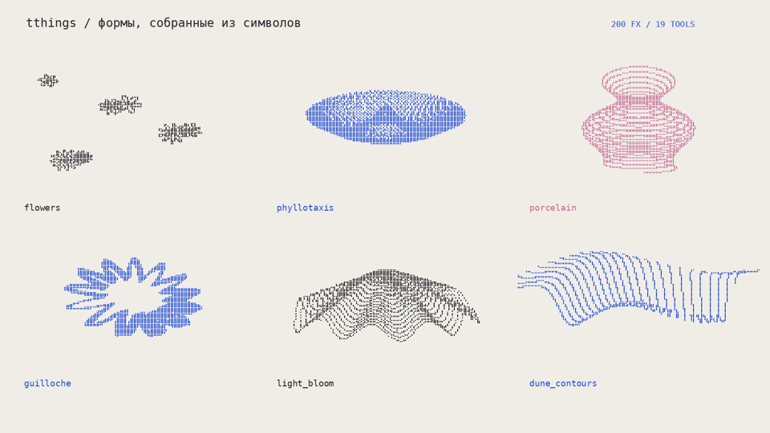

[Русский](README.md) · [Install](#install) · [Gallery](docs/SHOWCASE.md) · [Releases](https://github.com/user9x21imi/ttools/releases)

Music, messages, a VPN and a little motion. **ttools** brings four terminal apps into one keyboard-driven launcher, with a shared interest in ASCII art.

## Your workspace

Pick an app, press Enter, get on with your day. Quiet generative forms leave room for the interface.


## The collection

| App | What it does |
| --- | --- |
| **tspotify** | Spotify search, library, playlists and playback |
| **ttelegram** | Chats, messages, images, files and voice notes |
| **TVPN** | VPN controls, connection status and an interactive globe |
| **tthings** | 200 visual effects and 19 system tools |

**tspotify** keeps your library and playback close. Spotify Premium is required for playback.

**ttelegram** supports QR login, 2FA, mouse controls and saved drafts. Linux is included in the published suite. A native Windows x64 preview is being integrated, without WSL; it needs Windows Terminal 1.22+ with SIXEL. Interactive Windows testing is still pending. There is no macOS package yet.

**TVPN** puts connection status and region controls beside an ASCII globe. System setup may ask for administrator privileges. Real tunnels on every supported OS have not been verified by this preview.

**tthings** has 219 built-in modes: 200 effects and 19 tools. Botanics, light ribbons, interference patterns and procedural surfaces share a catalog with practical utilities. External projects are listed separately.



[Explore the gallery](docs/SHOWCASE.md) · [Catalog audit](docs/EFFECTS.md)

## Make it yours

Use **↑/↓** to choose an app, **Enter** to launch it, **/** to search and **Q** to leave. **N** changes the background; **Space** pauses motion. Once an app starts, its own keys take over.

```sh
ttools --no-motion
```

Use `ttools --low-power` to limit background size and frame rate.

Transparency comes from your terminal. The launcher keeps your current terminal profile, background and opacity.

## Install

The current published suite is a preview. Linux includes all four apps. The Windows package with native Telegram is a review candidate, not a published suite release yet. [Installation details](docs/INSTALL.md) cover prerequisites and platform limits.

**Linux x86_64**

```sh
curl -fsSL https://raw.githubusercontent.com/user9x21imi/ttools/main/install.sh | sh -s -- --preview
```

**Windows x64 — currently published partial suite**

```powershell
& ([scriptblock]::Create((irm https://raw.githubusercontent.com/user9x21imi/ttools/main/install.ps1))) -Preview -AllowPartial
```

**macOS — Apple Silicon / Intel, without Telegram**

```sh
curl -fsSL https://raw.githubusercontent.com/user9x21imi/ttools/main/install.sh | sh -s -- --preview --allow-partial
```

Open a new terminal and run `ttools`. Initial setup downloads shared dependencies. App logins happen afterwards.

## Compatibility

| Platform | Spotify | Telegram | TVPN | tthings |
| --- | --- | --- | --- | --- |
| Linux x86_64 | Included | Included | Included | Included |
| Windows x64 | Preview | Native review candidate | Preview | Preview |
| macOS ARM / Intel | Preview | — | Preview | Preview |

A platform archive is not proof that account login, audio hardware or VPN connectivity has been tested on that OS. [Validation](docs/VALIDATION.md) records the actual checks.

## Updates

ttools checks for suite updates at startup and installs the apps together. Settings and saved sessions live outside the versioned application files. If the network is unavailable, the installed version stays usable. Close running apps before updating.

## Read more

[Installation and updates](docs/INSTALL.md) · [Design](docs/DESIGN.md) · [Media sources](docs/MEDIA.md) · [Validation](docs/VALIDATION.md) · [Component licenses](THIRD_PARTY.md)

The launcher is [MIT licensed](LICENSE). Bundled apps have their own licenses. This is an independent project, not an official Spotify or Telegram client.
