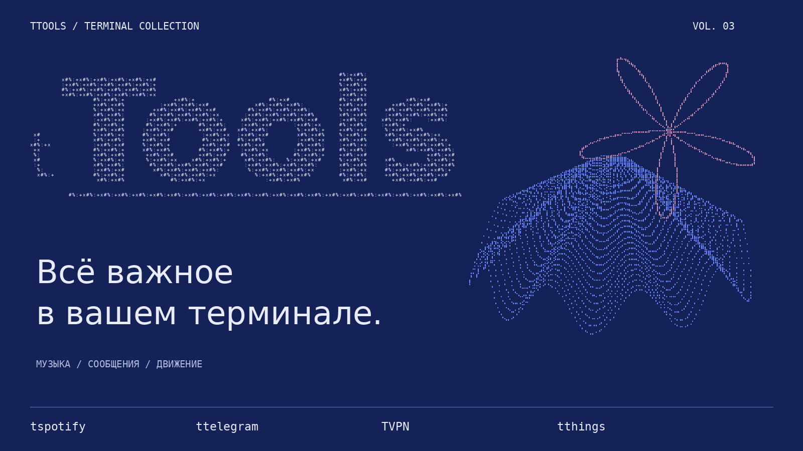

[Русский](README.md) · [Install](#install) · [Gallery](docs/SHOWCASE.md) · [Releases](https://github.com/user9x21imi/ttools/releases)

Music, conversations, a VPN and a little motion. **ttools** brings four terminal apps into one keyboard-driven launcher, with a shared visual language of characters, quiet colour and open space.

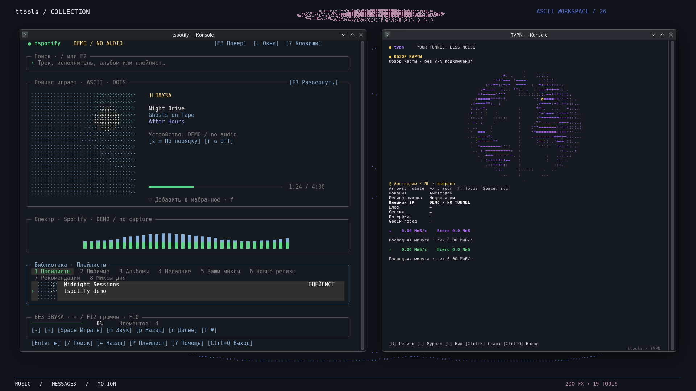

Choose an app with **↑/↓**, press **Enter**, and return to the launcher when you leave it. **/** opens search. Your terminal keeps its own background and transparency.

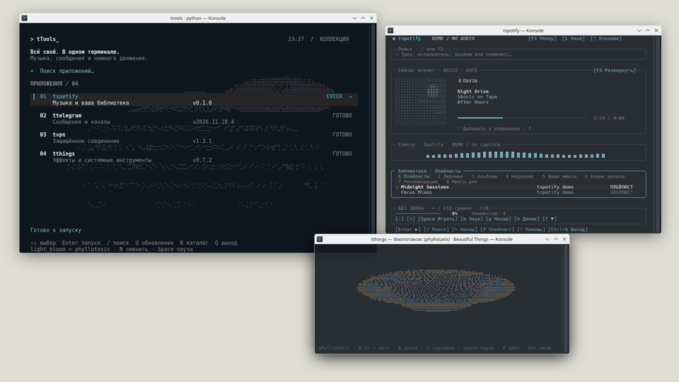

## The collection

| App | What it does |
| --- | --- |
| **tspotify** | Search, library, playlists, playback and visualisation |
| **ttelegram** | Chats, images, files, stickers and voice notes |
| **TVPN** | Connection controls, regions, a globe and traffic indicators |
| **tthings** | 200 visual effects and 19 system tools: 219 built-in modes |

### tspotify / music you can see

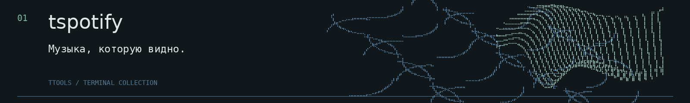

A dotted cover, your library and playback controls in one view. Search for artists and tracks, browse playlists, favourites, albums and saved mixes. Tabs, volume and seeking work with a mouse as well as the keyboard.

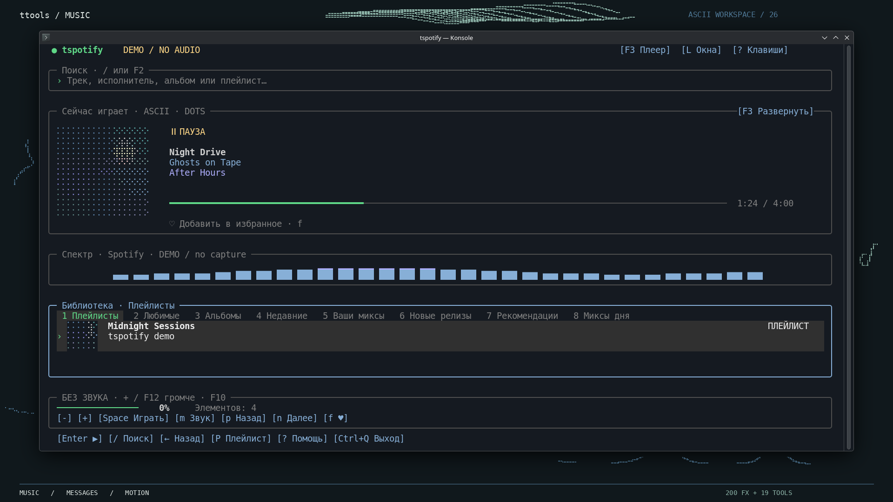

**F3** opens the large player: artwork and visualisation take over from the lists. Cover styles and window layouts are adjustable. The client remembers your session and restores the last track and position on pause.

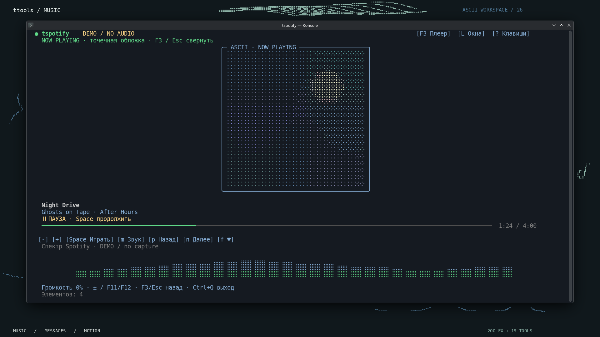

Spotify Premium is required for playback. Spectrum availability depends on the platform and audio setup; see the [app documentation](components/tspotify/source/README.md).

### ttelegram / room for a conversation

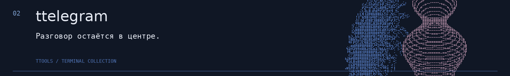

Chats on the left, history on the right, your draft below. Photos, files and quick actions share the same layout. QR login, 2FA, stickers, GIFs, voice notes, mouse controls and saved drafts are supported.

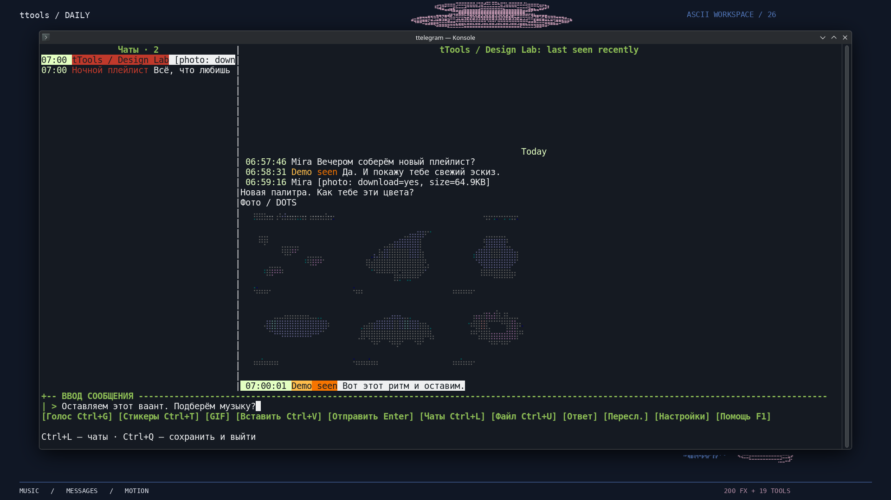

**Ctrl+L** returns to chats; **Ctrl+Q** saves state and exits. Linux is included in the published suite. Native Windows x64 is a review candidate, without WSL; it requires Windows Terminal 1.22+ with SIXEL. There is no macOS package yet.

### TVPN / a view of your network

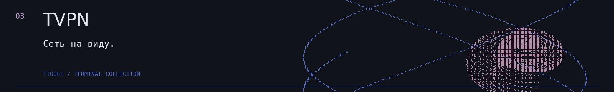

Rotate the globe, zoom in and choose a region. Connection status, network details and separate upload/download graphs remain in view.

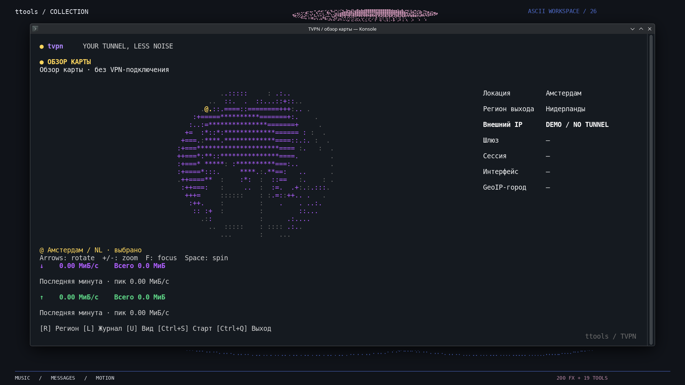

System setup may ask for administrator privileges. Real VPN tunnels on every supported OS have not been verified by this preview.

### tthings / 219 ways to change the mood

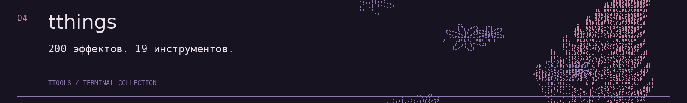

**200 effects and 19 tools.** Light ribbons, botanics, interference and procedural sculptures. Leave a scene in its own terminal or browse the collection using search, categories, previews, favourites and random selection.

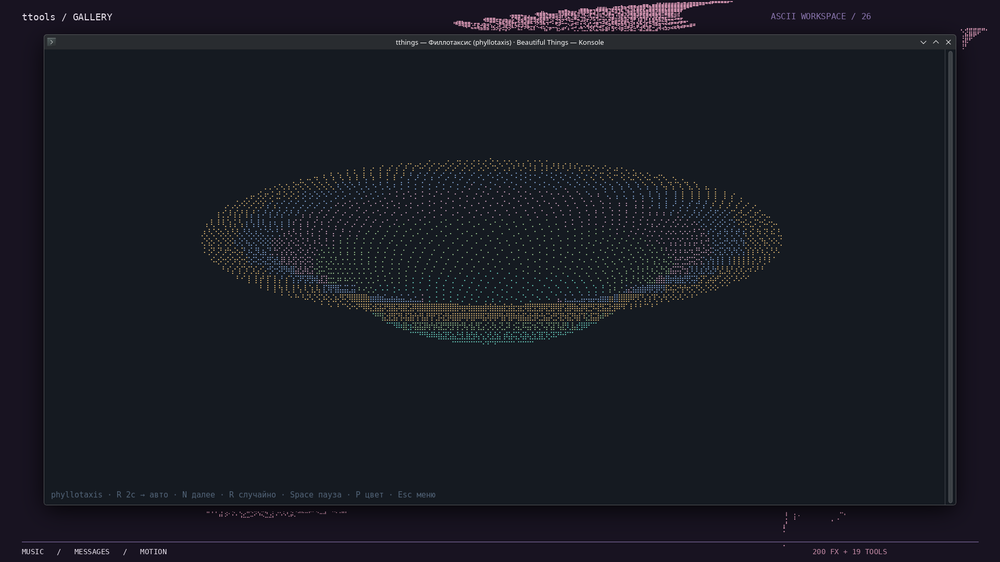

A calendar, timer, calculator and system utilities sit beside the graphics. External projects are listed separately and are not part of the 219 built-in modes.

## Shapes made of characters

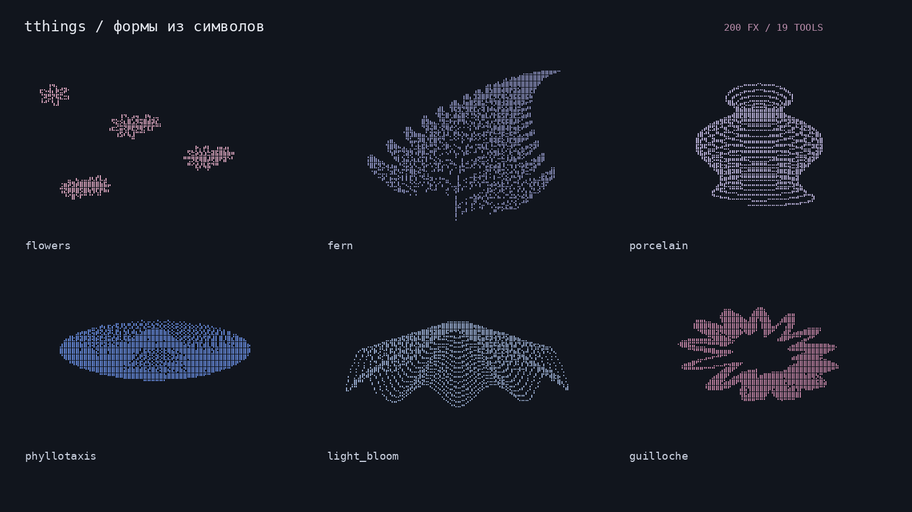

This presentation draws on five existing studies: **00, 02, 03, 04 and 07**. [Selected compositions and the full gallery](docs/SHOWCASE.md) · [Effect catalog](docs/EFFECTS.md)

## Everyday rhythms

**Music & Focus:** a large player, one live scene and room to breathe.

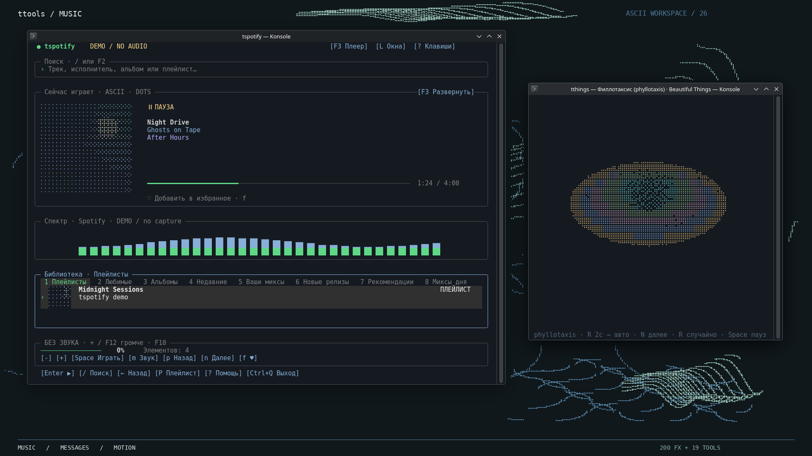

**Daily Setup:** music and conversations, with artwork kept in the margins.

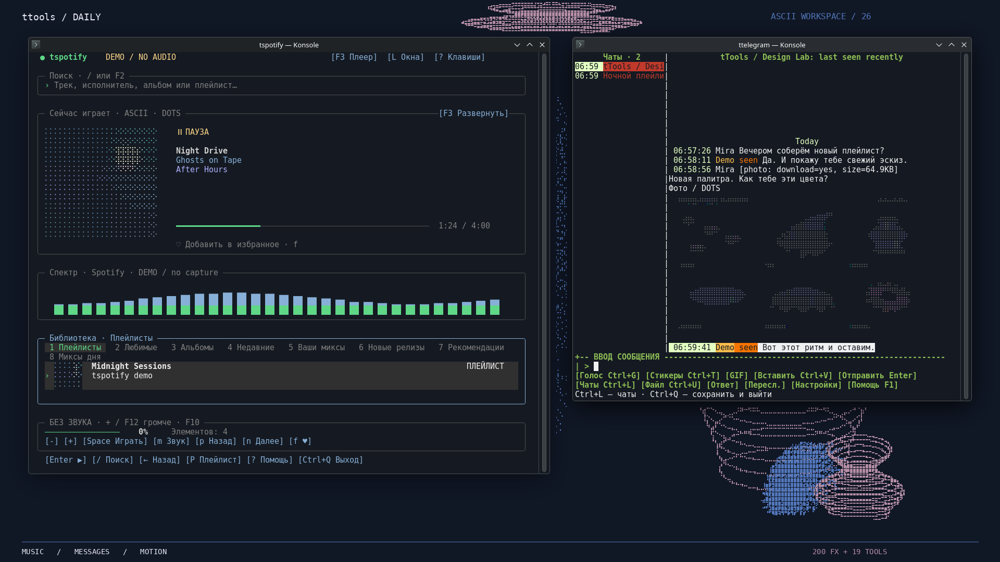

[Three more workspaces](docs/SHOWCASE.md).

## Make it yours

**N** changes the background pair, **Space** pauses motion and **Q** leaves the launcher. Each app owns its keyboard controls while it runs. Terminal profiles and opacity are kept as you set them.

```sh
ttools --no-motion
ttools --low-power
```

## Install

The current published suite is a preview. Linux includes all four apps. The Windows package with native Telegram is a review candidate, not a published suite release yet. [Installation details](docs/INSTALL.md) cover prerequisites and platform limits.

**Linux x86_64**

```sh
curl -fsSL https://raw.githubusercontent.com/user9x21imi/ttools/main/install.sh | sh -s -- --preview
```

**Windows x64 — currently published partial suite**

```powershell
& ([scriptblock]::Create((irm https://raw.githubusercontent.com/user9x21imi/ttools/main/install.ps1))) -Preview -AllowPartial
```

**macOS — Apple Silicon / Intel, without Telegram**

```sh
curl -fsSL https://raw.githubusercontent.com/user9x21imi/ttools/main/install.sh | sh -s -- --preview --allow-partial
```

Open a new terminal and run `ttools`. Initial setup downloads shared dependencies. App logins happen afterwards.

## Compatibility

| Platform | Spotify | Telegram | TVPN | tthings |
| --- | --- | --- | --- | --- |
| Linux x86_64 | Included | Included | Included | Included |
| Windows x64 | Preview | Native review candidate | Preview | Preview |
| macOS ARM / Intel | Preview | — | Preview | Preview |

A platform archive is not proof that account login, audio hardware or VPN connectivity has been tested on that OS. [Validation](docs/VALIDATION.md) records the actual checks.

## Updates

ttools checks for suite updates at startup and installs the apps together. Settings and saved sessions live outside the versioned application files. If the network is unavailable, the installed version stays usable. Close running apps before updating.

## Read more

[Installation and updates](docs/INSTALL.md) · [Design](docs/DESIGN.md) · [Media sources](docs/MEDIA.md) · [Validation](docs/VALIDATION.md) · [Component licenses](THIRD_PARTY.md)

The launcher is [MIT licensed](LICENSE). Bundled apps have their own licenses. This is an independent project, not an official Spotify or Telegram client.
