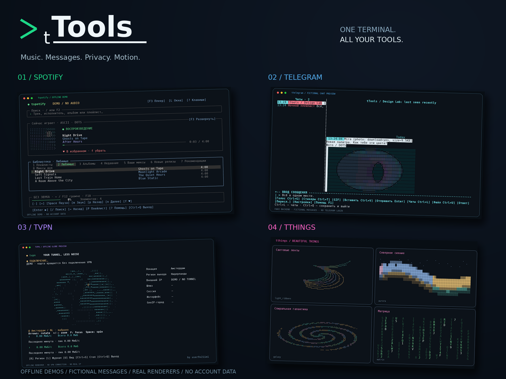
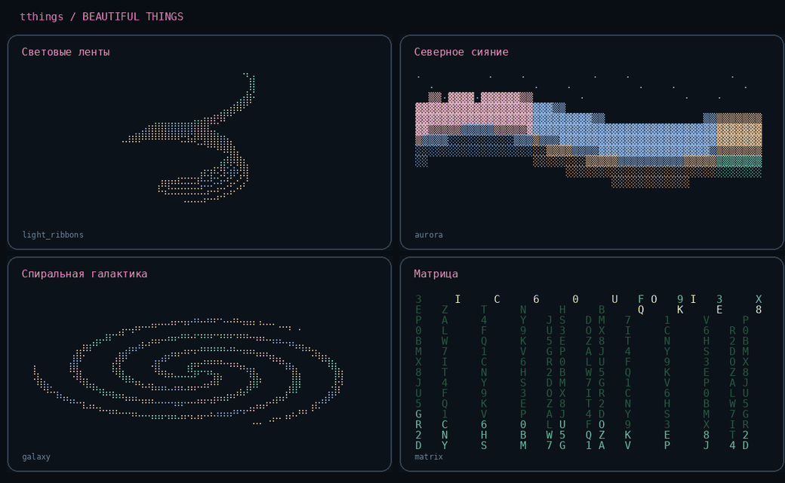
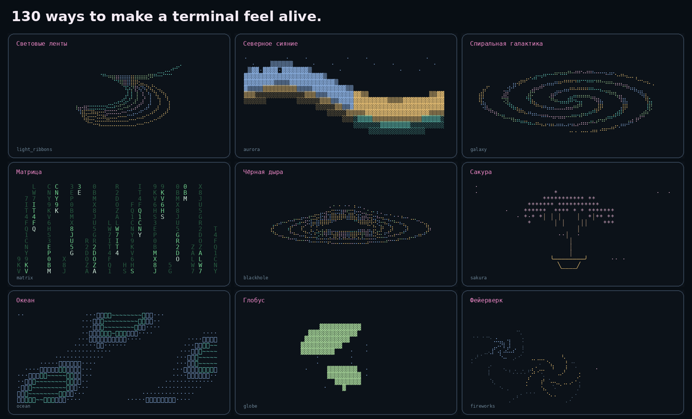
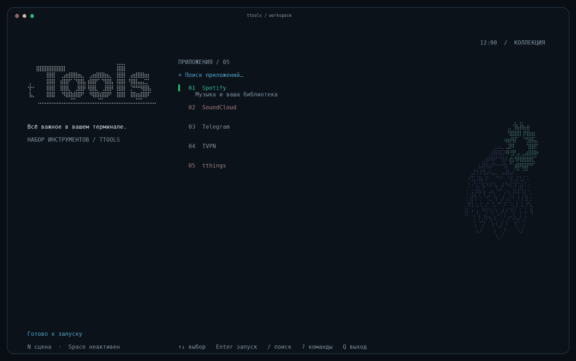

<p align="center"></p>

<p align="center">
<a href="https://github.com/user9x21imi/ttools/actions/workflows/release.yml"></a>

<a href="LICENSE"></a>

</p>

**ttools** объединяет Spotify, Telegram, VPN и системные инструменты в одном
терминальном клиенте. Быстрый выбор с клавиатуры, собственный цвет каждого
приложения, анимированная заставка и тихий фон из настоящих эффектов tthings.

> **Предварительная версия.** Linux x86_64 включает все четыре приложения. Windows x64 теперь включает нативный Telegram без WSL; его интерфейс ещё требует ручной проверки на Windows. На macOS Telegram пока недоступен.

<p align="center"><b>Музыка. Сообщения. Сеть. Живой экран.</b><br>
Один вход в ваши терминальные приложения — с клавиатуры, без поисков по папкам.</p>

## Установка одной командой

Команды ниже обращаются к опубликованному GitHub Release. До публикации
репозитория и успешной сборки Actions используйте локальные архивы из `dist/`;
сетевые команды не являются доказательством того, что релиз уже опубликован.

**Linux x86_64 — весь комплект:**

```sh
curl -fsSL https://raw.githubusercontent.com/user9x21imi/ttools/main/install.sh | sh -s -- --preview
```

**macOS Intel / Apple Silicon — пока без Telegram:**

```sh
curl -fsSL https://raw.githubusercontent.com/user9x21imi/ttools/main/install.sh | sh -s -- --preview --allow-partial
```

**Windows x86_64 · PowerShell — нативный Telegram preview:**

```powershell
& ([scriptblock]::Create((irm https://raw.githubusercontent.com/user9x21imi/ttools/main/install.ps1))) -Preview
```

Перед первой установкой закройте прежние окна этих приложений; сохранённый вход останется на месте.
После установки откройте новый терминал и выполните **`ttools`**. На Linux
создаётся ярлык в меню, на macOS — `~/Applications/ttools.command`;
на Windows команды добавляются в пользовательский PATH.

Нужны сеть и Python 3.10+ для первоначального bootstrap на Unix. Установщик
сам готовит CPython 3.14 через uv, если нужной версии ещё нет. На Windows
недостающий Python устанавливается через WinGet. В Ubuntu/Debian bootstrap
может установить необходимые системные пакеты с запросом sudo. Установка
защищённого VPN-backend требует штатного запроса администратора; сам клиент
работает от обычного пользователя. На SteamOS read-only root не отключается.
Полные требования и режимы — [INSTALL.md](docs/INSTALL.md).

| Скачать ZIP после публикации релиза | Запустить после распаковки |
|---|---|
| [INSTALL LINUX · весь комплект](https://github.com/user9x21imi/ttools/releases/download/v1.1.0-preview.2/ttools-linux-x86_64.zip) | `Install-ttools.sh` |
| [INSTALL macOS ARM · без Telegram](https://github.com/user9x21imi/ttools/releases/download/v1.1.0-preview.2/ttools-macos-arm64.zip) | `Install-ttools.command` |
| [INSTALL macOS Intel · без Telegram](https://github.com/user9x21imi/ttools/releases/download/v1.1.0-preview.2/ttools-macos-x86_64.zip) | `Install-ttools.command` |
| [INSTALL WINDOWS · Telegram preview](https://github.com/user9x21imi/ttools/releases/download/v1.1.0-preview.2/ttools-windows-x86_64.zip) | `Install-ttools.cmd` |

Для локальных архивов содержимое и запускаемые файлы те же. Если macOS
блокирует загруженный `.command`, разрешите запуск штатными средствами системы.
Windows `.cmd` использует установленный Python Launcher (`py`); для автоматической
подготовки Python с нуля используйте PowerShell-команду выше.

```text
+------------------------- INSTALL tTools -------------------------+
|  One command -> Verify SHA-256 -> Install apps -> Open ttools    |
|  No login during install. No music. No automatic VPN connection. |
+----------------------------------------------------------------+
```

## Внутри

| Приложение | Цвет выбора | Возможности |
|---|---|---|
| **tspotify** | 🟢 зелёный | Spotify, поиск и библиотека, браузерный/QR-вход, точечные обложки, спектр, локальное управление встроенным движком |
| **ttelegram** | 🔵 синий | QR/2FA, чаты, сообщения, фото, стикеры/GIF, голосовые, мышь и сохраняемые черновики; Linux и Windows preview |
| **TVPN** | 🟣 фиолетовый | Riseup VPN, регионы, ASCII-глобус, показатели трафика, штатное восстановление сети при выходе |
| **tthings** | 🌺 фуксия | 130 эффектов, 11 системных инструментов, календарь и мониторинг, оконные эффекты; внешние проекты устанавливаются отдельно |

В будущей библиотеке зарезервирован порядок **Spotify → SoundCloud → YouTube →
Telegram → VPN → tthings**. SoundCloud будет оранжевым, YouTube — красным.
Эти два клиента ещё не входят в установку.

Spotify требует Premium и сеть для встроенного воспроизведения. Авторизация
приложений выполняется при первом открытии каждого клиента; установщик её
не запрашивает и не переносит данные с другого компьютера.

## Spotify · ваша музыка, меньше шума

<p align="center"></p>

Найдите трек, откройте любимый плейлист и управляйте воспроизведением, оставаясь
в терминале. Обложки собираются из цветных точек, а панели можно переставлять
и разворачивать. Поиск, библиотека, текущий трек и управление громкостью находятся
рядом — не нужно переключаться между разными окнами.

- Поиск треков, исполнителей, альбомов и плейлистов; любимые и недавние.
- Встроенное воспроизведение и Spotify Connect, обложки и спектр реального аудио.
- Браузерный или QR-вход, память сессии, управление транспортом и громкостью.

```sh
tspotify --demo --no-splash  # посмотреть интерфейс без аккаунта и звука
```

На GIF запущен настоящий автономный demo-режим: треки и обложка демонстрационные,
звук не воспроизводится и не захватывается. Для обычного встроенного
воспроизведения нужны Spotify Premium и сеть.

## Telegram · переписка под рукой

<p align="center"></p>

Список чатов слева, переписка справа, поле ввода сразу под сообщениями.
Фотографии можно показывать обычными изображениями или цветными точками DOTS.
Черновики сохраняются, а стикеры, вложения и настройки открываются прямо из
клиента — клавишей или кнопкой мыши.

- Вход по QR и поддержка двухэтапной проверки.
- Сообщения, ответы, пересылка, фото, стикеры/GIF и голосовые.
- Мышь, выбор файлов, буфер обмена и переключаемое расположение панелей.

```text
Ctrl+L  Чаты       Ctrl+T  Стикеры       Ctrl+V  Вставить
Ctrl+O  Настройки                       Ctrl+Q  Сохранить и выйти
```

GIF записан с настоящего интерфейса на изолированном fake-backend. Имена,
переписка и изображение вымышлены; Telegram-вход и сетевые запросы не выполнялись.
Telegram доступен на Linux и в предварительной нативной сборке Windows x64. macOS пока не поддерживается.

## TVPN · видеть, что происходит с соединением

<p align="center"></p>

Выберите регион на карте, посмотрите состояние туннеля и следите за показателями
сети в одном окне. Вращающийся ASCII-глобус помогает ориентироваться в регионах;
состояние подключения, проверка выхода и остановка показаны отдельно.

- Бесплатные шлюзы Riseup, выбор региона и интерактивная карта.
- Статус, длительность сессии, трафик и графики; журнал рядом с панелью.
- Штатная остановка с ожиданием восстановления сети и защищённый backend.

```text
R       Выбор региона        Стрелки / +/-  Карта и масштаб
Ctrl+S  Остановить/запустить  Ctrl+Q         Очистка сети и выход
```

В GIF использованы реальные функции отрисовки TVPN с демонстрационной моделью:
карта вращается, затем показан STOPED. VPN не подключался, реальный IP и
пользовательские сетевые данные в записи отсутствуют.

## tthings · терминал может быть живым

<p align="center"></p>

Иногда хочется оставить на экране спокойное сияние, а иногда — открыть
«Матрицу», полёт среди звёзд или вращающуюся галактику. В tthings есть
**130 эффектов** и **11 системных инструментов**: можно искать сцены,
сохранять любимые, включать случайный выбор и переходить к полезным панелям.

- Природа, космос, ретро и генеративные сцены; переключение и автопоказ.
- Календарь, мониторинг и системная информация; отдельные окна эффектов.
- Приглушённые рендереры tthings используются и в фоне самого ttools.

```sh
tthings --effect light_ribbons
tthings --effect galaxy
tthings --tool calendar
```

<p align="center"></p>

Все кадры этой галереи построены настоящим API рендереров tthings. Это
декоративные сцены; они не выдают случайные значения за системный мониторинг.
Оконные режимы зависят от Tk/Qt и рабочего стола. Внешние проекты каталога
не входят в автоматическую установку.

## Интерфейс

<p align="center"></p>

Логотип `> tTools` с маленькой `t` и подчёркиванием появляется с быстрым fade.
В фоне работают приглушённые процедурные сцены; новая случайная сцена выбирается
через 30–120 секунд. Клавиша N переключает её сразу. Общая анимация ниже построена теми же функциями отрисовки ttools.
Материалы отдельных приложений сняты в автономных режимах или построены
их настоящими рендерерами; пользовательские данные не используются.

Профиль Konsole задаёт **22% прозрачности** и размытие. Интерфейс сохраняет
фон терминала вместо сплошной заливки. В других терминалах прозрачность
настраивается средствами самого терминала. PNG/GIF показывают тёмную
подложку; системный эффект прозрачности в них не записан.

| Клавиша | Действие |
|---|---|
| ↑ / ↓, J / K | Выбрать программу |
| Enter / двойной щелчок | Запустить выбранную |
| / | Поиск; Enter/Esc завершает ввод |
| N | Следующий случайный эффект |
| U | Обновить сведения об обновлениях |
| R | Перечитать каталоги |
| Q / Esc | Закрыть ttools |

Дочернее приложение получает терминал целиком. Пока оно открыто, его клавиши
принадлежат ему. После штатного выхода снова появляется библиотека ttools.
Spotify и VPN закрываются через Ctrl+Q; для VPN дождитесь завершения очистки.
Общий клиент не перехватывает клавиши дочерней программы.

## Автообновление

Управляемая установка ttools проверяет канал при запуске не чаще раза в сутки.
После появления новой версии она скачивает ZIP для своей ОС, проверяет SHA-256
и полный перечень файлов, устанавливает в отдельный каталог и переключает
активную версию после успешной подготовки. После обновления клиент открывается
уже из новой версии. При недоступной сети запускается установленная версия.
Preview-установка остаётся в preview-канале.

```sh
ttools --update       # проверить и применить новую версию сейчас
ttools --list         # показать установленные приложения
ttools --status       # сведения об управляемой установке
```

У Spotify в управляемой установке отключён конкурирующий внутренний updater.
Telegram обновляется авторским установщиком с проверкой патча и отдельным venv.
tthings приходит как часть согласованного снимка. TVPN сохраняет свой защищённый
backend и штатный updater; новая версия комплекта устанавливает его через
официальный install-only API. Запущенный ttools/его приложения блокируют общую
установку и обновление. Параллельная перезапись не допускается. Если TVPN самостоятельно обновился до
версии новее включённой в комплект, установка старого backend блокируется.

Настройки, OAuth, Telegram-сессия, переписка и журналы остаются в штатных
пользовательских каталогах. Откат `ttools --rollback` доступен для установок
без TVPN. Для комплекта с TVPN он запрещён: защищённый backend требует
согласованного штатного отката, а не переключения одного пользовательского файла.

Общий канал распространяет версии приложений, включённые в новый релиз ttools.
Новый коммит отдельного приложения сам по себе не обновит весь комплект:
нужно включить его проверенный пакет в следующий релиз ttools.

## Новые приложения и папки

```sh
ttools --import '/путь/к/папке'
```

В папке должен находиться `apps.local.json`:

```json
{
  "schema_version": 1,
  "apps": [{
    "id": "my-tool",
    "name": "Мой инструмент",
    "command": ["./bin/my-tool", "--option"],
    "version": "1.0.0"
  }]
}
```

Команды выполняются argv-массивом, без shell. Относительный исполняемый путь
считается от манифеста. Пробелы и кириллица поддерживаются. Повторяющийся id
заменяет прежнюю запись среди подключённых каталогов; встроенные управляемые
приложения имеют приоритет, чтобы старые обёртки не создали циклический запуск.
R перечитывает подключённые каталоги. Подключённые
сторонние приложения запускаются из их установки и не становятся автоматически
частью общего обновляемого комплекта.

## Разработка и релиз

```sh
python3 -m unittest discover -s tests -v
python3 installer.py --plan
python3 tools/build_release.py --handoff '/путь/к/ttools-handoff'
```

[GitHub Actions](.github/workflows/release.yml) проверяет код на Linux/macOS/Windows,
собирает четыре архива (Linux x86_64, macOS Intel/ARM, Windows x86_64), публикует
SHA256SUMS.txt и suite-update.json. Preview публикуется только после успешных
проверок. Наличие installer-архива не заменяет проверку реального VPN-туннеля,
входа в аккаунт или звука на соответствующей ОС.

[Инструкция установки](docs/INSTALL.md) · [Результаты проверок](docs/VALIDATION.md) ·
[Как сняты GIF и коллажи](docs/MEDIA.md) · [Лицензии компонентов](THIRD_PARTY.md) · [MIT](LICENSE)
