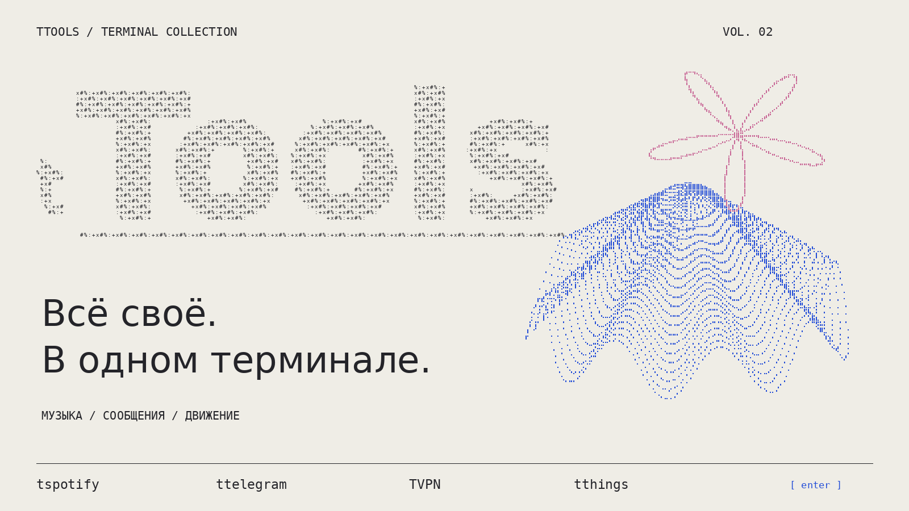
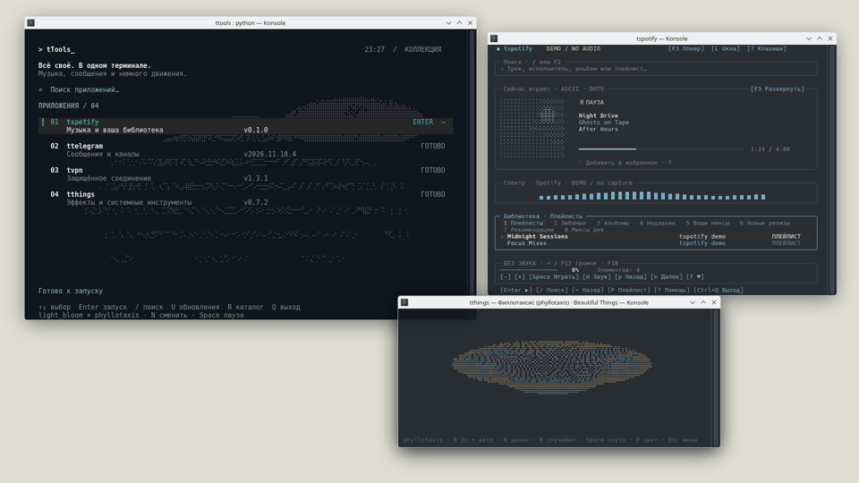
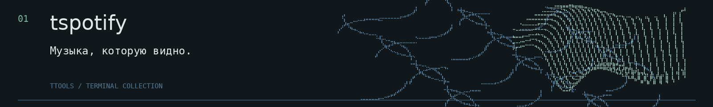
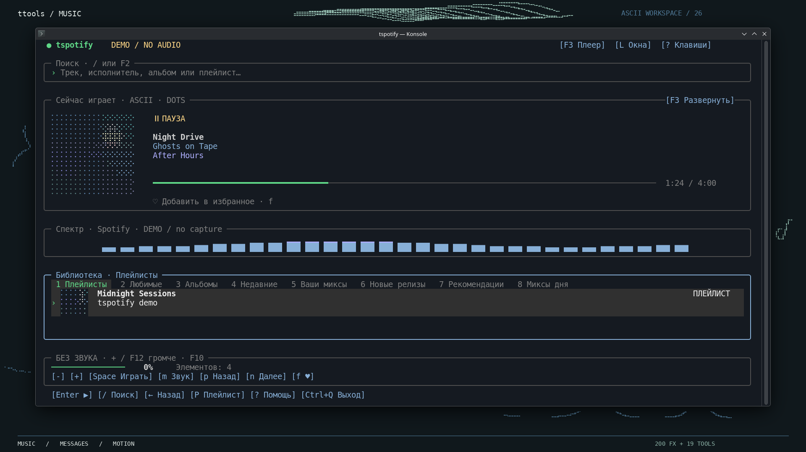
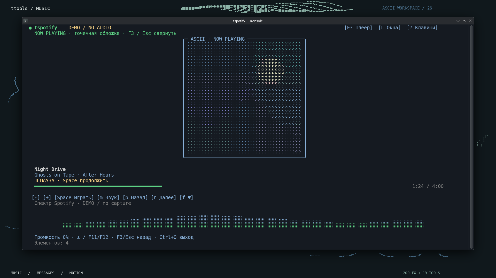
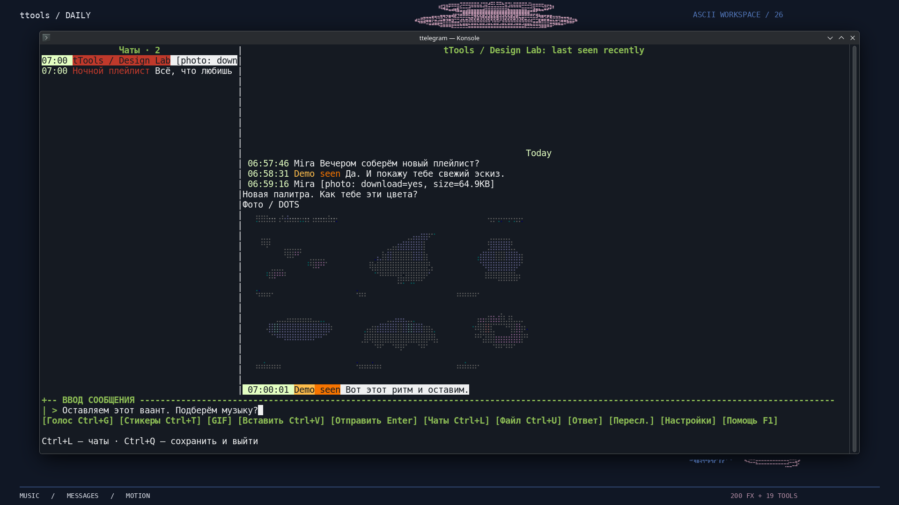
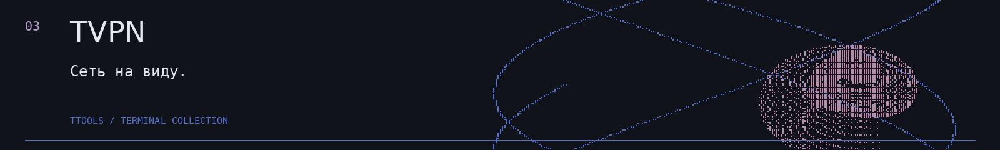
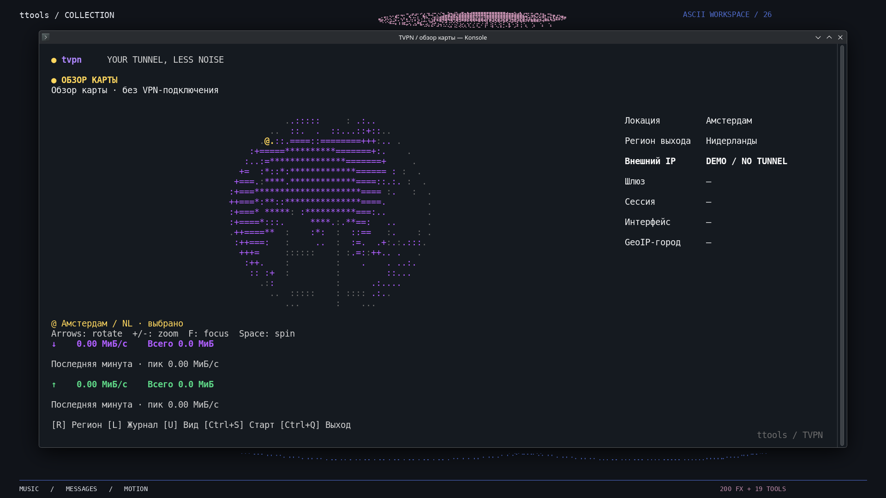
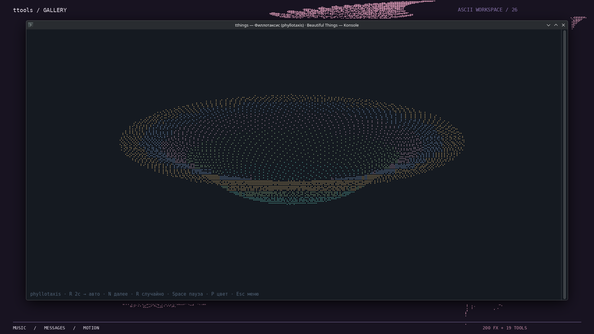
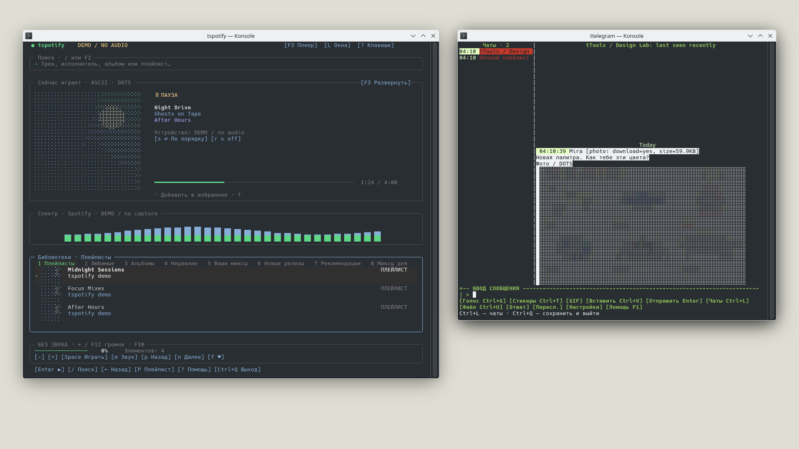

[](https://github.com/user9x21imi/ttools/actions/workflows/release.yml)
[](https://github.com/user9x21imi/ttools/releases)
[](LICENSE)
[English](README.en.md)

Музыка, переписка, сеть и живой экран. **ttools** собирает пять терминальных приложений в одном месте. Выбирай с клавиатуры, открывай нужное — и оставайся в своём рабочем пространстве.

[Установка](#установка) · [Приложения](#внутри) · [Большая галерея](docs/SHOWCASE.md)

## Один терминал — свои привычки

Музыка слева, карта и состояние сети справа. У каждого приложения свой характер, у коллекции — общий язык: символы, спокойный цвет и место для воздуха.


Лаунчер открывает выбранное приложение в своём терминале и возвращается после выхода. **↑/↓** — выбор, **Enter** — запуск, **/** — поиск. Фон и прозрачность остаются настройками твоего терминала.



## Внутри

| Приложение | Для чего |
| --- | --- |
| **tspotify** | Музыка: поиск, библиотека, плейлисты, плеер и визуализация |
| **SoundCloud** | Музыка: лента, поиск, библиотека и комментарии на форме волны |
| **ttelegram** | Переписка: чаты, изображения, файлы, стикеры и голосовые |
| **TVPN** | Сеть: соединение, регионы, интерактивная карта и трафик |
| **tthings** | Графика и инструменты: 200 эффектов + 19 утилит = 219 режимов |

### tspotify / музыка, которую видно

При запуске открывается обновлённое системное окно в стиле Fastfetch: оно показывает сведения о компьютере, пока загружается Spotify, и остаётся ещё несколько секунд после готовности клиента. На компактном экране 78×24 панель спектра остаётся видимой.



Точечная обложка, библиотека и плеер на одном экране. Ищи треки и исполнителей, открывай плейлисты, любимые альбомы, недавнее и сохранённые миксы. Кнопки, вкладки, громкость и перемотка работают с мышью — клавиатура тоже всегда под рукой.



**F3** оставляет музыку в центре: крупная обложка и визуализация вместо списков. Есть разные стили обложек, настройка раскладки и сохранение сессии. Последний трек и позиция возвращаются на паузе, чтобы следующий запуск не начинал играть неожиданно.



Для воспроизведения нужен **Spotify Premium**. Доступность спектра зависит от платформы и аудионастроек — [подробности](components/tspotify/source/docs/README.ru.md).

### SoundCloud / музыка с комментариями

Форма волны показывает весь трек и отмечает комментарии на нужных местах. Наведи курсор на метку, чтобы прочитать её; при воспроизведении комментарий появляется, когда плейхед доходит до него. Поиск, библиотека, лента и управление плеером остаются в том же терминальном интерфейсе.

**F3** открывает большой плеер, **F4** или **B** — библиотеку с мини-плеером. Для живого воспроизведения нужны вход в SoundCloud, FFmpeg и SDL2. В комплекте приложения есть офлайн-демо. Этот preview включает SoundCloud только для Linux x86_64; живой вход и потоки ещё требуют проверки на целевой машине. [Управление и установка](components/tsoundcloud/source/README.md).

### ttelegram / разговор остаётся в центре


Чаты слева, история справа, сообщение внизу. Текст, изображения и быстрые действия живут в одной раскладке: можно спокойно читать переписку, открыть фото, прикрепить файл или продолжить черновик.



QR-вход и 2FA, фото, стикеры и GIF, голосовые, мышь и сохранённые черновики. **Ctrl+L** возвращает к чатам, **Ctrl+Q** сохраняет состояние и закрывает клиент.

В комплекте Telegram доступен на Linux. Нативный Windows x64 — preview-кандидат, без WSL; для него нужен Windows Terminal 1.22+ с SIXEL. На macOS Telegram пока отсутствует.

### TVPN / сеть на виду



Глобус здесь — часть управления: поворачивай карту, меняй масштаб и выбирай регион. Рядом остаются статус соединения, сведения о сети и отдельные графики входящего и исходящего трафика.



Системная часть может запросить права администратора. Работа реальных туннелей на всех платформах этим preview не подтверждена.

### tthings / 219 способов сменить настроение


**200 эффектов и 19 инструментов — всего 219 режимов.** Световые ткани, ботанические формы, интерференция и процедурные скульптуры. Выбери сцену, оставь её в отдельном терминале или переходи от одной к другой, пока не найдёшь своё настроение.



Поиск, категории, предпросмотр, избранное и случайный выбор помогают ориентироваться в коллекции. Рядом с графикой — календарь, таймер, калькулятор и системные утилиты. Внешние проекты перечислены отдельно и не входят в 219 режимов.

## Формы, собранные из символов

Цветы, папоротники, световые поверхности и орнаменты. Плотность точек меняет свет, линии превращаются в объём — всё это материал для собственного рабочего пространства.


В оформлении этой страницы использованы пять уже созданных сочетаний: **00, 02, 03, 04 и 07**. [Отобранные композиции и остальные варианты](docs/SHOWCASE.md) · [Каталог эффектов](docs/EFFECTS.md).

## Два повседневных ритма

**Music & Focus.** Большой плеер и одна живая форма рядом. Волны и прохладные акценты остаются в свободных полях стола.


**Daily Setup.** Музыка, переписка и немного графики на полях. Всё нужное видно, декоративные детали не занимают место разговора.



Ещё три композиции — [в расширенной галерее](docs/SHOWCASE.md).

## Сделай терминал своим

**N** меняет сочетание фонов, **Space** останавливает движение, **Q** закрывает лаунчер. Внутри приложения действуют его собственные клавиши. Прозрачность, фон и профиль терминала не переключаются.

```sh
ttools --no-motion    # неподвижный фон
ttools --low-power    # меньше нагрузка
```

## Установка

Новый SoundCloud и обновление macOS войдут в следующий preview после сборки и публикации. Сейчас команды устанавливают последний опубликованный комплект из канала preview.

Поставка пока предварительная. Команда загружает комплект и готовит зависимости; вход в аккаунты выполняется после установки. Для Spotify нужен Premium, для VPN — системная настройка. [Требования и подробная установка](docs/INSTALL.md).

**Linux x86_64**

```sh
curl -fsSL https://raw.githubusercontent.com/user9x21imi/ttools/main/install.sh | sh -s -- --preview
```

**Windows x64 · PowerShell, опубликованный комплект без Telegram**

```powershell
& ([scriptblock]::Create((irm https://raw.githubusercontent.com/user9x21imi/ttools/main/install.ps1))) -Preview -AllowPartial
```

**macOS · Apple Silicon / Intel, без Telegram**

```sh
curl -fsSL https://raw.githubusercontent.com/user9x21imi/ttools/main/install.sh | SSL_CERT_FILE=/etc/ssl/cert.pem sh -s -- --preview --allow-partial
```

Открой новый терминал и выполни `ttools`.

Предпочитаешь архив? [Все загрузки](https://github.com/user9x21imi/ttools/releases) содержат установщик для своей платформы. Первый запуск требует доступа к сети для общих зависимостей; Windows-пакет Telegram содержит свои зависимости для офлайн-установки.

## Совместимость

| Платформа | Spotify | SoundCloud | Telegram | TVPN | tthings |
| --- | --- | --- | --- | --- | --- |
| Linux x86_64 | Да | Preview | Да | Да | Да |
| Windows x64 | Preview | — | Preview-кандидат | Preview | Preview |
| macOS ARM / Intel | Preview | — | — | Preview | Preview |

Наличие сборки не означает, что вход в аккаунт, звук и VPN-туннель проверены на каждой ОС. [Что проверено](docs/VALIDATION.md).

## Обновления

ttools проверяет новые версии комплекта при запуске и устанавливает обновления вместе. На macOS лаунчер сначала предлагает обновление; выбор можно подтвердить или пропустить. Настройки и сохранённые сессии хранятся отдельно. Без сети можно продолжать пользоваться установленной версией. Перед обновлением открытые приложения нужно закрыть.

[Как устроены обновления и восстановление](docs/INSTALL.md).

## Документация

- [Установка, требования и обновления](docs/INSTALL.md)
- [Каталог эффектов и результаты аудита](docs/EFFECTS.md)
- [Визуальная система](docs/DESIGN.md)
- [Скриншоты, GIF и воспроизведение демонстраций](docs/MEDIA.md)
- [Проверки и ограничения](docs/VALIDATION.md)
- [Что вошло в релиз](docs/RELEASE.md)
- [Лицензии компонентов](THIRD_PARTY.md)

Лаунчер — [MIT](LICENSE). У приложений и библиотек свои лицензии. Это независимый проект, не официальный клиент Spotify или Telegram.
