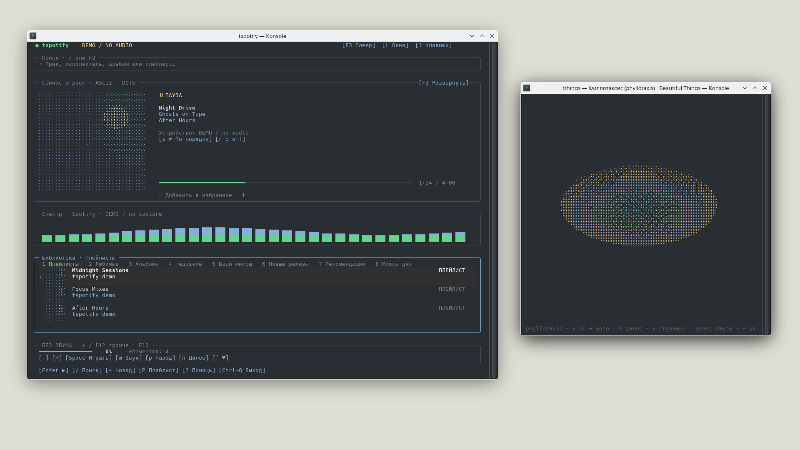
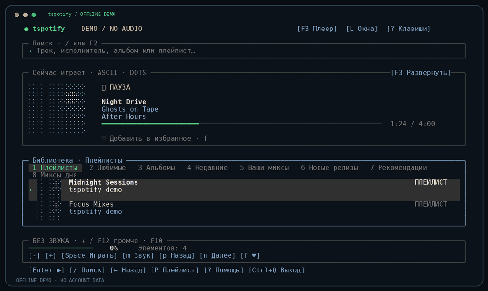
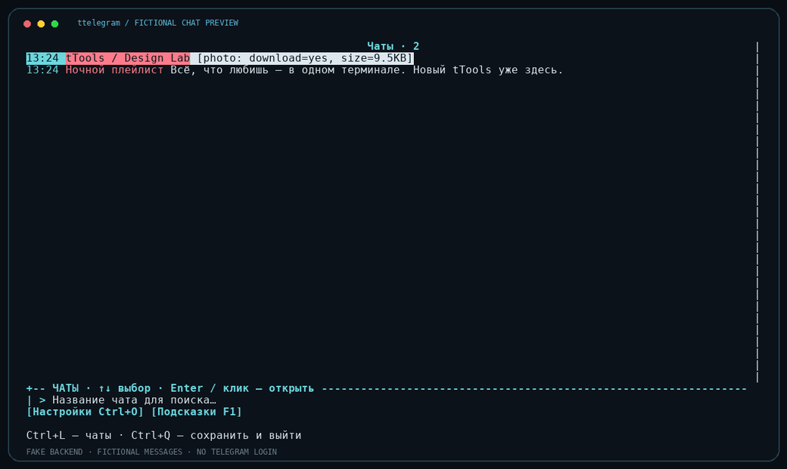
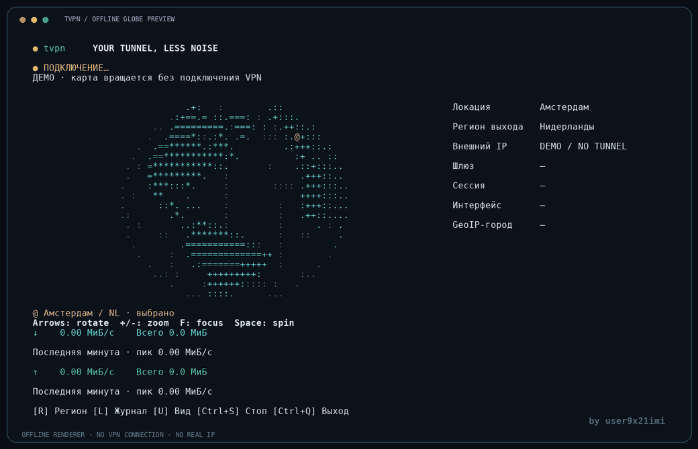
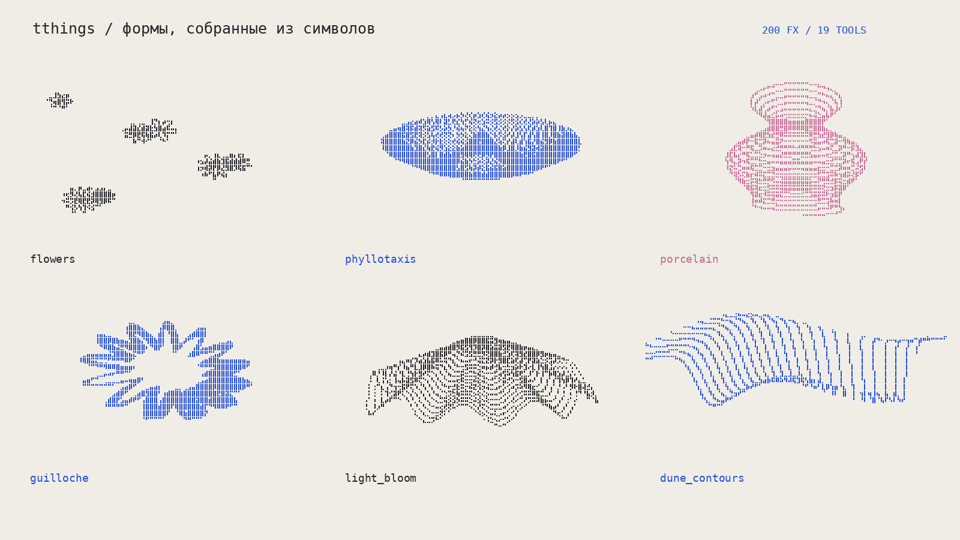

[](https://github.com/user9x21imi/ttools/actions/workflows/release.yml)
[](https://github.com/user9x21imi/ttools/releases)
[](LICENSE)
[English](README.en.md)

Музыка, сообщения, VPN и немного движения. **ttools** собирает четыре терминальных приложения в одном лаунчере — с управлением с клавиатуры и живой ASCII-графикой.

[Установить](#установка) · [Посмотреть приложения](#внутри) · [Документация](#документация)

## Рабочее пространство

Открыл терминал, выбрал приложение, продолжил своё дело. Вокруг — тихие волны, ботанические формы и поверхности, собранные из символов.




[Все рабочие столы и 24 графических микса](docs/SHOWCASE.md).

## Внутри

| Приложение | Для чего |
| --- | --- |
| **tspotify** | Spotify: поиск, библиотека, плейлисты и воспроизведение |
| **ttelegram** | Telegram: чаты, сообщения, изображения, файлы и голосовые |
| **TVPN** | Управление VPN, состояние подключения и интерактивный глобус |
| **tthings** | 200 визуальных эффектов и 19 системных инструментов |

### tspotify / музыка рядом

Поиск по Spotify, любимые альбомы, плейлисты и очередь. Управляй музыкой, не уходя из терминала. Для воспроизведения нужен **Spotify Premium**.



### ttelegram / переписка под рукой

Чаты, QR-вход и 2FA, фото, стикеры, GIF, файлы и голосовые сообщения. Есть мышь и сохранение черновиков.



В опубликованном комплекте доступен на Linux. Нативная версия Windows x64 подготовлена как кандидат в следующий **preview**, без WSL; проверка интерфейса и устройств на Windows ещё впереди. Для Windows нужен Windows Terminal 1.22+ с SIXEL. На macOS Telegram пока отсутствует.

### TVPN / сеть на виду

Состояние соединения, выбор региона и вращающийся ASCII-глобус. Установка системной части может запросить права администратора. Работа реальных туннелей на всех платформах этим preview не подтверждена.



### tthings / терминал может больше

**219 режимов: 200 эффектов и 19 инструментов.** Цветы, световые ткани, интерференция, процедурные поверхности — рядом с календарём и системными утилитами. Выбирай сцену под настроение или оставь её жить в отдельном окне.



[Каталог и обзор всех эффектов](docs/EFFECTS.md). Внешние проекты вынесены отдельно и не входят в эти 219 режимов.

## Сделай терминал своим

ASCII и Unicode здесь — материал для изображения: плотность точек, линии, изгибы и пустое пространство. Спокойный фон оставляет место для текста. У каждого приложения свой акцент: зелёный, синий, фиолетовый или фуксия.

В лаунчере **↑/↓** выбирают приложение, **Enter** запускает его, **/** открывает поиск. **N** меняет фон, **Space** останавливает движение, **Q** закрывает лаунчер. Внутри приложения действуют его собственные клавиши.

Для спокойного рабочего пространства:

```sh
ttools --no-motion
```

Для меньшей нагрузки есть `ttools --low-power`.

Прозрачность зависит от терминала и композитора. В Konsole лаунчер временно выбирает профиль ttools и возвращает прежний после выхода. [Настройки и другие терминалы](docs/INSTALL.md).

## Установка

Оформление и новые фоны в этой ветке подготовлены для проверки. Опубликованный релиз — [1.1.0-preview.1](https://github.com/user9x21imi/ttools/releases/tag/v1.1.0-preview.1); Windows Telegram ещё не включён в его общий архив. Команды ниже устанавливают опубликованный комплект.

Поставка пока предварительная. Команда загружает комплект и готовит зависимости; вход в аккаунты выполняется после установки. Для Spotify нужен Premium, для VPN — системная настройка. [Требования и подробная установка](docs/INSTALL.md).

**Linux x86_64**

```sh
curl -fsSL https://raw.githubusercontent.com/user9x21imi/ttools/main/install.sh | sh -s -- --preview
```

**Windows x64 · PowerShell, опубликованный комплект без Telegram**

```powershell
& ([scriptblock]::Create((irm https://raw.githubusercontent.com/user9x21imi/ttools/main/install.ps1))) -Preview -AllowPartial
```

**macOS · Apple Silicon / Intel, без Telegram**

```sh
curl -fsSL https://raw.githubusercontent.com/user9x21imi/ttools/main/install.sh | sh -s -- --preview --allow-partial
```

Открой новый терминал и выполни `ttools`.

Предпочитаешь архив? [Все загрузки](https://github.com/user9x21imi/ttools/releases) содержат установщик для своей платформы. Первый запуск требует доступа к сети для общих зависимостей; Windows-пакет Telegram содержит свои зависимости для офлайн-установки.

## Совместимость

| Платформа | Spotify | Telegram | TVPN | tthings |
| --- | --- | --- | --- | --- |
| Linux x86_64 | Да | Да | Да | Да |
| Windows x64 | Preview | Кандидат в следующий preview | Preview | Preview |
| macOS ARM / Intel | Preview | — | Preview | Preview |

Наличие сборки не означает, что вход в аккаунт, звук и VPN-туннель проверены на каждой ОС. [Что проверено](docs/VALIDATION.md).

## Обновления

ttools проверяет новые версии комплекта при запуске и устанавливает обновления вместе. Настройки и сохранённые сессии хранятся отдельно. Без сети можно продолжать пользоваться установленной версией. Перед обновлением открытые приложения нужно закрыть.

[Как устроены обновления и восстановление](docs/INSTALL.md).

## Документация

- [Установка, требования и обновления](docs/INSTALL.md)
- [Каталог эффектов и результаты аудита](docs/EFFECTS.md)
- [Визуальная система](docs/DESIGN.md)
- [Скриншоты, GIF и воспроизведение демонстраций](docs/MEDIA.md)
- [Проверки и ограничения](docs/VALIDATION.md)
- [Что вошло в релиз](docs/RELEASE.md)
- [Лицензии компонентов](THIRD_PARTY.md)

Лаунчер — [MIT](LICENSE). У приложений и библиотек свои лицензии. Это независимый проект, не официальный клиент Spotify или Telegram.
