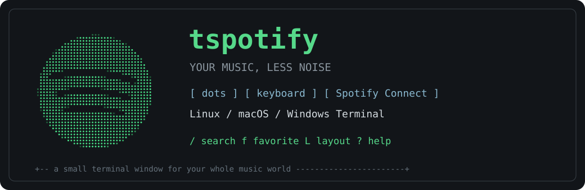

<p align="center"></p>


<p align="center">
<a href="https://github.com/user9x21imi/tspotify/actions/workflows/ci.yml"></a>
<a href="LICENSE"></a>
<a href="docs/README.ru.md">По-русски</a>
</p>

```text
+-- tspotify ---------------------------------------------------------------+
|  / Search your music                                           ? Help   |
+----------------------+----------------------------------------------------+
|  . . : : . .         |  NOW PLAYING                                        |
|  : : . . : :         |  Night Drive / Ghosts on Tape                       |
|  . : . : . :         |  =======--------------------------  1:24 / 4:12     |
|  : . : . : .         |  [f] Save / remove from your library                |
+----------------------+----------------------------------------------------+
|  SPECTRUM       . . . : : : : : : . . .                                  |
+---------------------------------------------------------------------------+
|  [1] Playlists       [2] Liked songs       [3] Albums                      |
|  .:.  Midnight sessions                                                  |
|  :::  Focus mixes                                                        |
+---------------------------------------------------------------------------+
|  VOLUME  =======---------  45%                      - / +  |  m Mute       |
+---------------------------------------------------------------------------+
```

A keyboard-driven Spotify client with **colored dotted artwork**, tiny playlist and album covers, a smooth real-audio spectrum, and movable panels. Built for a terminal — no picture escape protocols or special icon fonts.

## Install

**[Download the latest release](https://github.com/user9x21imi/tspotify/releases/latest)** · Linux x86_64 · macOS Apple Silicon · macOS Intel · Windows x64

Each native archive includes Python, dependencies and the streaming engine. Extract it and run `./tspotify/tspotify` in a terminal; on macOS you can also open `Start tspotify.command`. Spotify Desktop is not required. CI builds and smoke-tests each target; live playback and audio capture still need real hardware and are not claimed as tested on every OS.

### Source installation

Use **Python 3.11 or newer** with `venv` and `pip` available. The commands below install into your user directory without root/admin access or Git. Source installs use an upstream engine unless a patched build is supplied; the native local controls and Jam require tspotify's patched engine. The Linux archive above includes it.

**Linux / macOS** — paste these three commands into your terminal:

```sh
python3 -m venv "$HOME/.local/share/tspotify/venv"
"$HOME/.local/share/tspotify/venv/bin/python" -m pip install "https://github.com/user9x21imi/tspotify/archive/refs/heads/main.zip"
"$HOME/.local/share/tspotify/venv/bin/tspotify"
```

**Windows PowerShell** — with Python 3.11+ and the Python launcher (`py`) installed:

```powershell
py -3 -m venv "$env:LOCALAPPDATA\tspotify\venv"
& "$env:LOCALAPPDATA\tspotify\venv\Scripts\python.exe" -m pip install "https://github.com/user9x21imi/tspotify/archive/refs/heads/main.zip"
& "$env:LOCALAPPDATA\tspotify\venv\Scripts\tspotify.exe"
```

To launch again, use the last command for your OS. The animated Fastfetch-style screen shows system details while the Spotify engine starts, then stays up for three seconds after readiness. Use `--no-splash` to skip it, `--no-motion` to disable interface transitions, or `--low-power` to reduce refresh rate and skip transitions. Add `--demo` to preview offline without an account or audio, or `--muted` for a silent start. Integrated playback requires Spotify Premium. Source installations download a verified upstream streaming engine on first use; native archives already include their engine.

<details><summary>Development installation</summary>

```sh
git clone https://github.com/user9x21imi/tspotify.git
cd tspotify
python3 -m venv .venv
# Activate .venv using your shell's usual command.
python -m pip install -e '.[dev]'
python -m pytest
```
</details>

## Sign in

`tspotify` opens Spotify's authorization page in your browser. If you're already signed in there, confirm access. Your Spotify password is never requested by tspotify.

For QR sign-in:

```sh
tspotify login --qr
```

For a first run that also uses QR for any separate integrated-playback approval, run `tspotify --qr`.

Scan the code, approve Spotify access, and **paste the full callback address from your phone into the terminal**. Spotify's loopback callback points to your computer; a phone cannot finish that redirect automatically. Browser sign-in on the computer is the fastest route.

Integrated streaming may ask for a separate playback approval on first use. Existing tspotify / spotify_player credentials are reused when available. tspotify does not extract credentials from the official Spotify application's private storage.

## Spotify already open?

An available, signed-in Spotify Connect device is selected automatically. This can be your desktop Spotify, MacBook, phone or another device. The terminal remains your control surface.

```sh
tspotify devices
tspotify --device "My MacBook"
tspotify --device integrated
```

Desktop Spotify being installed is not the same as it being an available device: start it and sign in first. Spotify still requires a one-time authorization for library access.

## Keys

| Key | Action |
| --- | --- |
| `/`, `F2` | Focus search; Enter submits |
| `Tab`, `Esc` | Switch focus / leave search |
| `↑` / `↓`, `PgUp` / `PgDn` | Select / scroll |
| `Enter` | Open a playlist/album; play a selected track |
| `P` | Start the whole selected playlist/album |
| `←`, `Backspace` | Return to the previous list |
| `Space`, `n`, `p` | Play/pause, next, previous |
| `+`, `-`, `m` | Volume, mute/restore |
| `F7`, `F8`, `F9` | Previous track, play/pause, next track (also in search and dialogs) |
| `F10`, `F11`, `F12` | Mute/restore, volume down 5%, volume up 5% |
| `f` | Save / remove the current track from your library |
| `1`, `2`, `3` | Playlists, liked tracks, albums |
| `4`, `5`, `6`, `7`, `8` | Recent history, saved Spotify mixes, new releases, recommendations, saved daily mixes |
| `F3`, expand button, cover click | Expanded artwork, track details and a smooth dotted spectrum; F3/Esc returns |
| Mouse | Hover focuses panels; single click opens a playlist or plays a track, wheel scrolls; tabs and controls are clickable |
| `a` | Dots / text ASCII / block artwork |
| `s`, `r` | Shuffle, repeat |
| `L` | Layout editor: arrows select, `K`/`J` move, `c` swaps cover side, `v` toggles spectrum, Enter saves |
| `?`, `F1` | Full key reference |
| `Ctrl+Q`, `q`, `Ctrl+C` | Save the session, exit and stop the integrated engine |

The editorial layout, F3 player, transition recordings and render-only measurements are documented in [docs/EDITORIAL_UI.md](docs/EDITORIAL_UI.md).

## Fonts, terminals and transparency

Use a normal Unicode monospace font: **Cascadia Mono**, **Menlo**, **JetBrains Mono**, or **Fira Mono**. Dotted covers use standard Braille characters, not private-use Nerd Font icons. No font download or global font replacement is necessary.

If your terminal/font cannot display the dots:

```sh
tspotify --ascii
```

Recommended terminals: Windows Terminal with PowerShell, Terminal.app/iTerm2 on macOS, and Konsole/GNOME Terminal/foot on Linux. A minimum of 78 columns × 24 rows is required. The spectrum remains visible at this compact size; taller windows give the artwork and library more room. The application uses the terminal's background, so existing terminal transparency remains visible. Transparency itself is a terminal setting.

## Real audio spectrum

The 30 fps spectrum uses actual output audio, with separate attack/release smoothing. It does not animate random bars.

- **Linux:** captures the integrated Spotify engine's specific PulseAudio/PipeWire sink input with `parec --monitor-stream`. It does not capture the default mixed output. Stream recreation and output-device changes are detected automatically.
- **Windows / macOS:** automatic whole-system loopback is disabled. For visualization, route Spotify alone to a dedicated virtual audio channel, then set `TSPOTIFY_SPOTIFY_LOOPBACK` to that capture device's exact name or ID. A shared system-output channel is unsuitable. Without a dedicated channel, music works and the spectrum explains why it is unavailable.
- **External Spotify Connect:** the remote audio is not available locally; unrelated local sounds are never substituted.

The physical microphone is never chosen automatically. `TSPOTIFY_LOOPBACK` (the former shared-output option) is no longer used.

Visible transport buttons include volume −/+, play/pause, mute, previous/next and favorite. The footer, layout editor and help navigation have clickable controls too; click the progress bar to seek. Single-click list actions match Enter; a second event from a double-click does not accidentally play the first track of a just-opened playlist.

## Reliability and privacy

Commands are not reported as successful just because they were queued. Starting a track waits for an actual playing event or a confirmed remote-device state. Failures and Spotify rate limits are shown directly. Playlist pages and covers are cached; the screen is not completely repainted for every animation frame.

The integrated engine belongs to the terminal session and is stopped on exit, including errors and Ctrl+C. A separately running desktop Spotify remains a user-owned app.

OAuth tokens, listening data, playlist caches and logs stay in OS user-data directories. None are included in the repository, release artifacts or CI. `tspotify doctor` reports paths and capabilities without printing tokens.

## Platform and release status

CI runs unit/interface tests and builds native artifacts for Linux x86_64, macOS Apple Silicon/Intel and Windows x64. It does not have a Spotify Premium account, physical audio hardware, or permission to claim that live playback was exercised on every OS. The live account test is performed locally with the engine muted.

Release binaries are currently unsigned. macOS Gatekeeper / Windows SmartScreen may require explicit approval for an independently downloaded application. The project does not disable those OS protections.

[Architecture and testing](docs/DEVELOPMENT.md) · [Troubleshooting](docs/TROUBLESHOOTING.md) · [Release notes](CHANGELOG.md)

## Credits

Independent project, not affiliated with Spotify. Streaming uses [spotify_player](https://github.com/aome510/spotify-player), downloaded from its official releases with pinned SHA-256 hashes. Its license and third-party notices are preserved separately. The tspotify interface is [MIT licensed](LICENSE).

### Updates

Installed release builds check GitHub once a day before opening the player. A new stable release displays its version and asks `Install update? [y/N]`. Nothing installs unless you confirm. Downloads are pinned to that release and checked against its SHA-256 manifest. Spotify login and preferences are preserved. Restart `tspotify` after installation. Network failures never prevent opening the player.

Run `tspotify update` to check manually. Source checkouts keep their development environment unchanged unless you explicitly invoke this command.

### Discovery sections

Recent history includes available playlist/album contexts and unique recently played tracks. New releases and recommendations use Spotify data, with recommendations seeded by your own top tracks. Your Mixes and Daily Mixes show Spotify mixes saved in your library: save the desired mix in the official app to make it available here. These do not duplicate Spotify's private Home feed or pre-save countdowns. Availability depends on the authorization/API access granted by Spotify; restricted endpoints show an explanation rather than unrelated replacement content.

The expanded player uses 256×256 artwork and a real dotted spectrum. Mouse tracking is enabled only while the interface is open. Hold Shift when selecting text if your terminal reserves normal mouse actions for the application.

[Russian prompt for a separate SoundCloud project](docs/SOUNDCLOUD_PROMPT.ru.md).

### Session memory

Normal launches restore the last chosen volume, current track and position, open library section or playlist, selected row, search text and expanded-player view. Playback opens **paused**; press Space to continue from the saved position. The last nonzero volume is remembered for mute/restore too. A first launch uses 35% rather than forcing zero.

State is checkpointed while the UI runs and saved again on exit, including Ctrl+Q and normal terminal-close handling. `--muted` temporarily starts at zero and never overwrites the ordinary saved session; demo mode is separate as well. An already active external Spotify Connect device keeps its own live playback state. Session data lives in the private configuration directory shown by `tspotify doctor`.

### Volume keys with the terminal minimized

In KDE Plasma, run `tspotify install-shortcuts` once, then restart the client. F7 is previous track, F8 play/pause, F9 next track, F10 mute, F11 volume down 5%, and F12 volume up 5%, including while the terminal is minimized or another application has focus. The shortcuts belong to Spotify only while its interface is running and are released on normal exit. Existing shortcuts owned by other applications are not overwritten. Disable with `tspotify install-shortcuts --remove`.

Other desktop environments can bind their shortcut settings to `tspotify control volume-up`, `tspotify control volume-down`, and `tspotify control mute`. These commands only contact the running client; they never launch a player or open login. Automatic global-key setup is currently KDE-specific. Ordinary terminal input alone cannot receive keys while unfocused.

Volume presses are accumulated locally and serialized/coalesced to the newest requested value; stale playback polls do not replace that value. Current artwork has a separate worker from list thumbnails, selects a suitably sized CDN image, and caches the rendered dotted cells rather than recalculating them on every volume redraw.

Volume changes wait 180 ms for a burst to settle and send at most one HTTP update per second. Repeats at 0%/100% are discarded. A Spotify 429 keeps only the newest requested level and retries automatically after Retry-After; the UI distinguishes queued volume from the last confirmed value.
