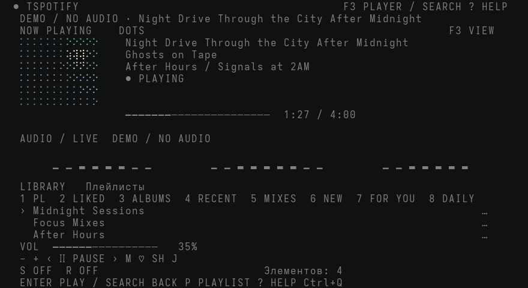
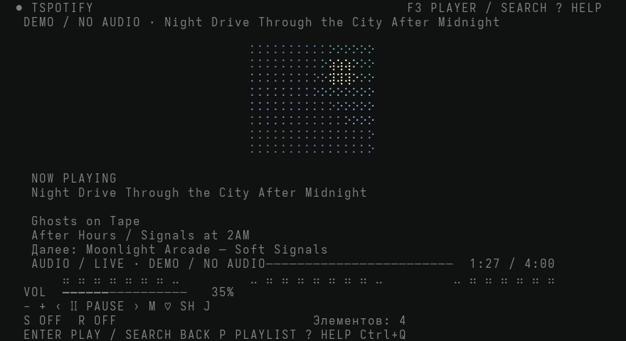
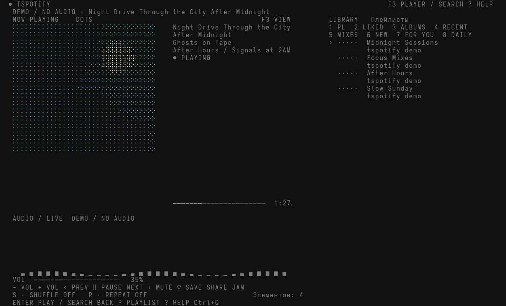
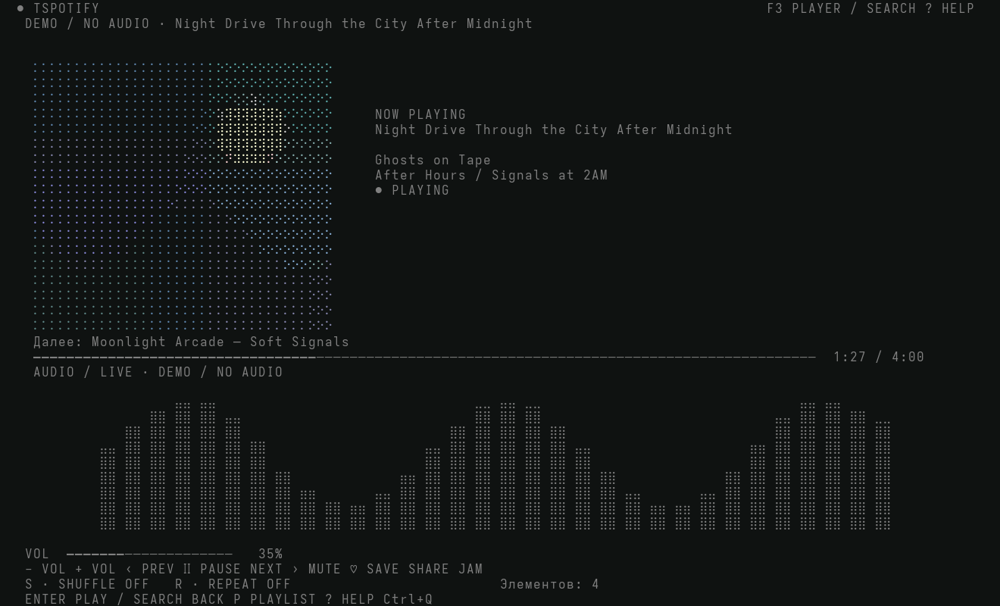
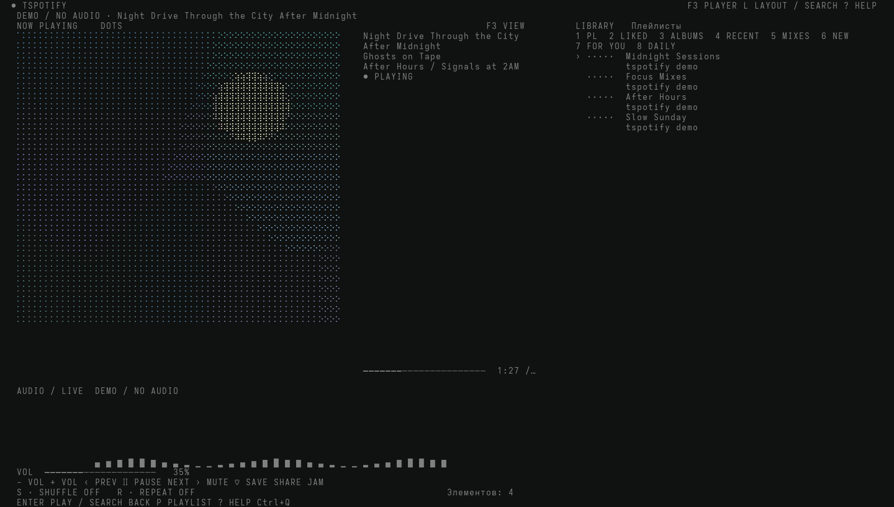
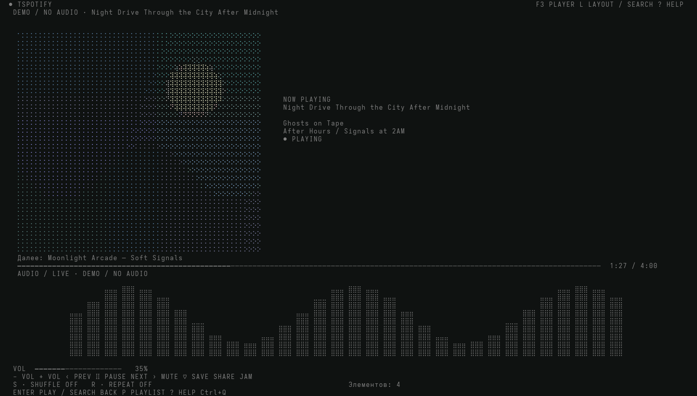
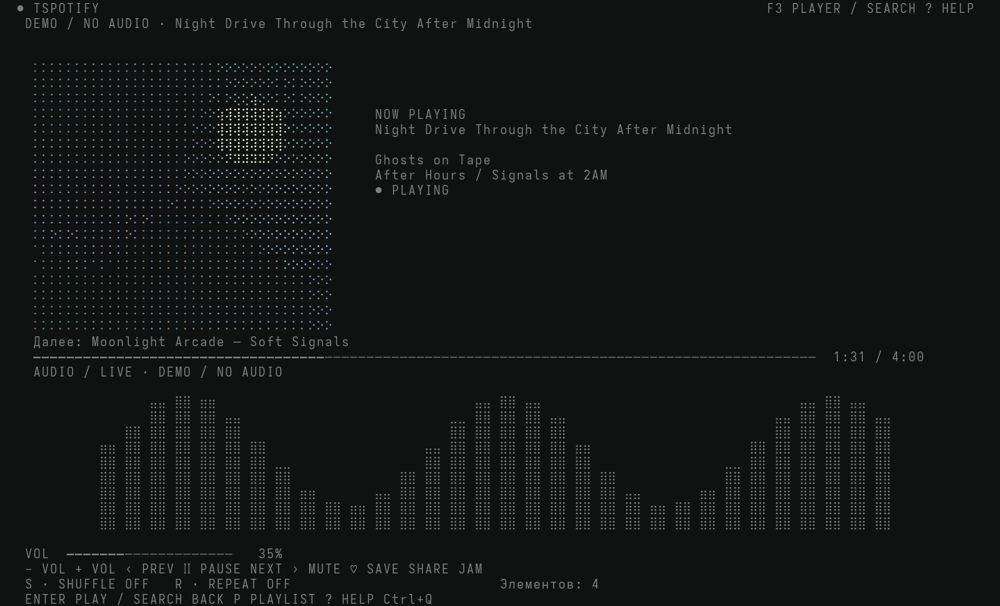
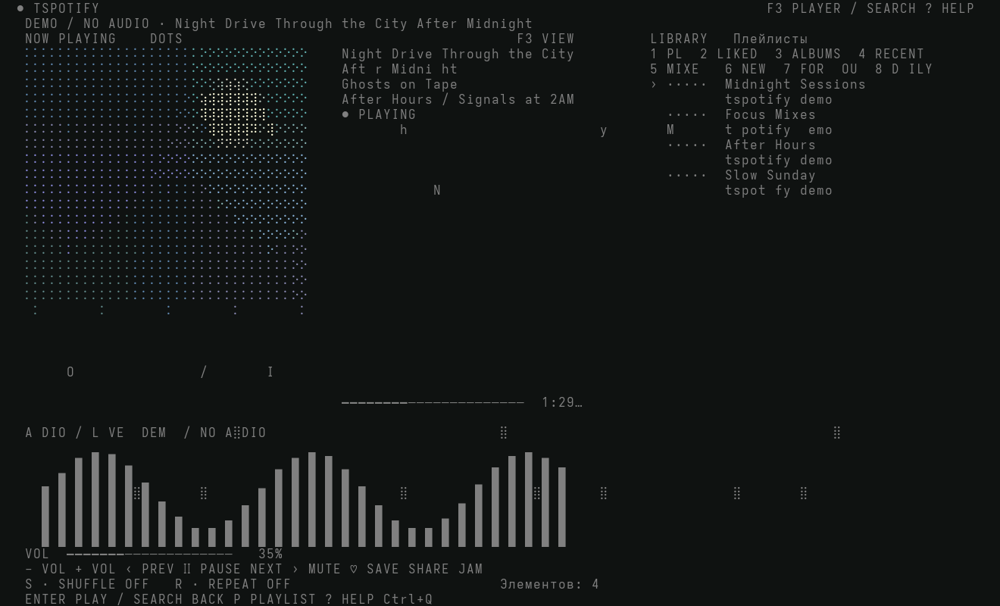

# Editorial player interface

The default screen puts the current track and its cached Braille cover beside a short
library list. F3 expands the cover into the main view, places track details beside or
under it, and gives the live audio visualizer its own area below the real playback
timeline. Track position continues to come from Spotify playback state; cover and panel
transitions never request new Spotify data.

Album art dissolves through a stable dither mask in 280 ms. The selected library marker
moves over 100 ms. F3/Esc uses a 210 ms grid transition. A newer cover replaces the
active transition from the currently displayed frame. `--no-motion` disables startup
and interface transitions; `--low-power` skips those transitions and limits the UI to
12 fps while audio capture is active or 6 fps otherwise. The equivalent environment
flags are `TSPOTIFY_REDUCED_MOTION=1` and `TSPOTIFY_LOW_POWER=1`.

Run the interface without an account or audio device:

```sh
tspotify --demo
```

## Captures

The PNG files show the ordinary screen and F3 player at compact, standard and wide
terminal sizes. GIFs record the 210 ms panel change and 280 ms artwork dissolve. Demo
visualizer bars are synthetic and explicitly marked `DEMO / NO AUDIO`; they are not
used as an audio-capture fallback.

| Size | Main screen | F3 player |
| --- | --- | --- |
| 80×24 |  |  |
| 120×40 |  |  |
| 160×50 |  |  |

**Artwork transition:** 

**Panel transition:** 

## Render measurements

`editorial-render-benchmark.json` records 120 Python render frames per case on the
current development host. It uses the offline demo API and a fake terminal screen, so
it measures composition and transition work without Spotify requests, audio capture or
terminal I/O. The values are useful for comparing layouts on the same host; they are
not cross-platform startup or terminal throughput benchmarks.

| Case | p50 | p95 | Maximum |
| --- | ---: | ---: | ---: |
| Main 80×24 | 1.07 ms | 1.11 ms | 2.84 ms |
| F3 80×24 | 0.95 ms | 0.98 ms | 2.72 ms |
| Main 120×40 | 2.70 ms | 4.05 ms | 5.05 ms |
| F3 120×40 | 3.25 ms | 5.02 ms | 13.34 ms |
| Cover dissolve 120×40 | 7.45 ms | 9.35 ms | 17.77 ms |
| F3 grid transition 120×40 | 4.06 ms | 5.86 ms | 16.97 ms |
| Main 160×50 | 5.42 ms | 7.29 ms | 17.11 ms |
| F3 160×50 | 5.75 ms | 7.57 ms | 18.36 ms |

Regenerate screenshots, recordings and measurements after UI changes:

```sh
python scripts/capture_editorial.py
```
