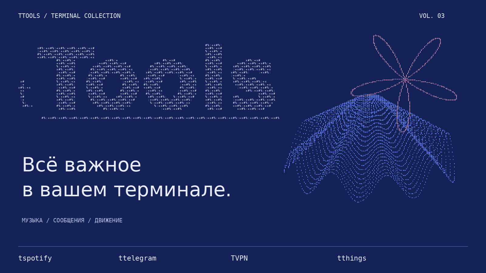
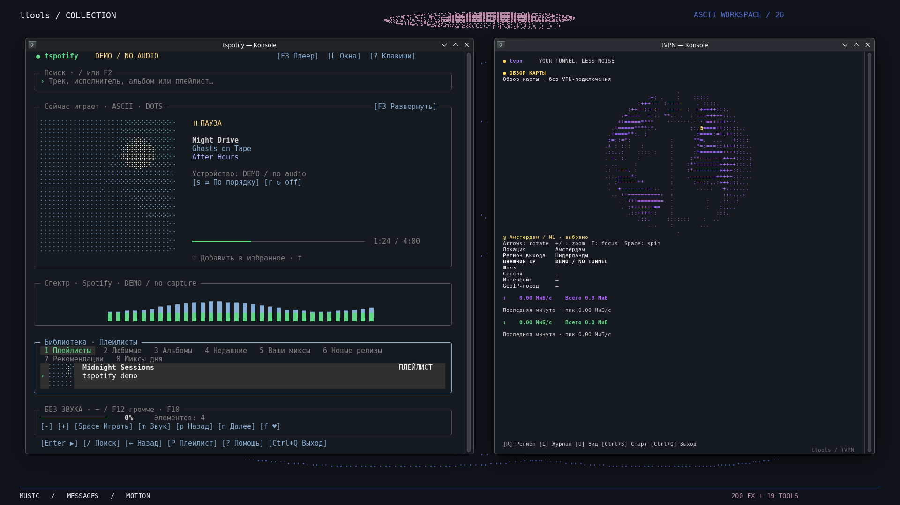
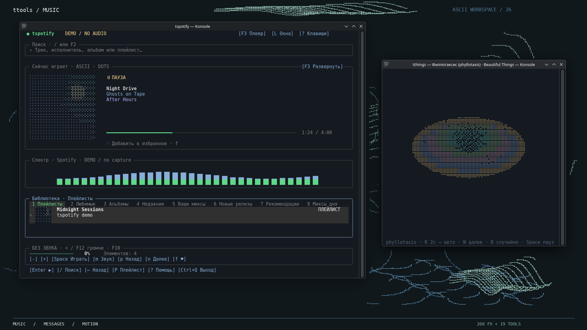
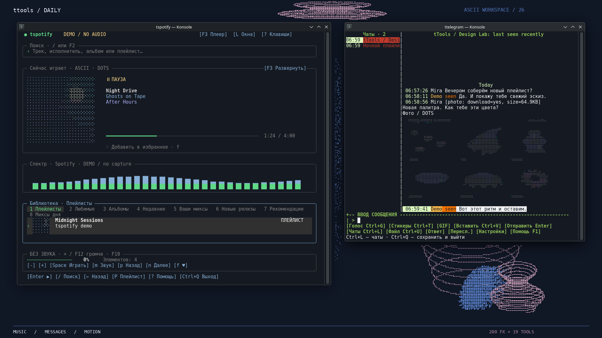

# PR №1 / визуальная проверка

[Открыть весь README](../README.md) · [Расширенная галерея](SHOWCASE.md)

В README теперь три рабочих стола, крупные новые снимки четырёх приложений и отдельные графические заголовки разделов. Фоны демонстрационных столов и окон тёмные. Использованы пять существующих сочетаний, новые серии эффектов не добавлялись.

## Главный экран

## Выбранный стол 01 / музыка и сеть

## Выбранный стол 02 / Music & Focus

## Выбранный стол 04 / Daily Setup

## Крупные интерфейсы

[Spotify: библиотека](assets/app-spotify.png) · [Spotify: плеер](assets/app-spotify-player.png) · [Telegram](assets/app-telegram.png) · [TVPN](assets/app-vpn.png) · [tthings](assets/app-tthings.png)

Все изображения выше — настоящие захваты отдельных изолированных столов 1920×1080. Hero и разделители — художественные композиции. Сообщения вымышлены, аккаунты и VPN-подключение для съёмки не используются. [Источники и повторение](MEDIA.md).
