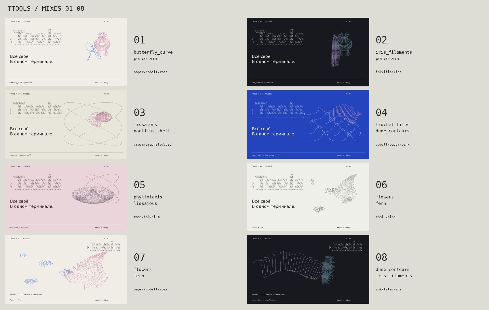
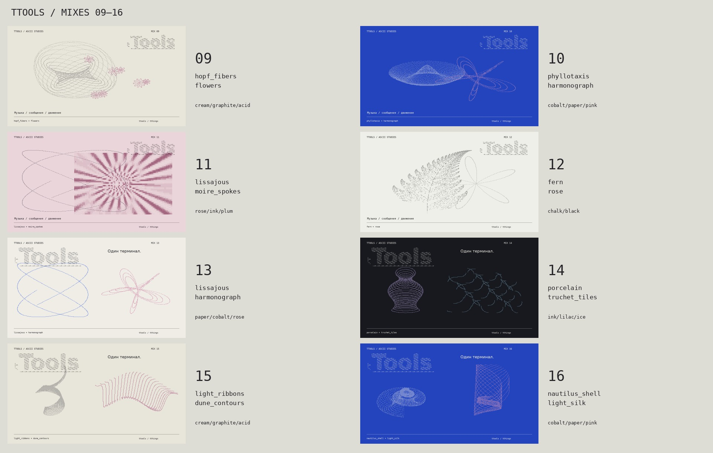
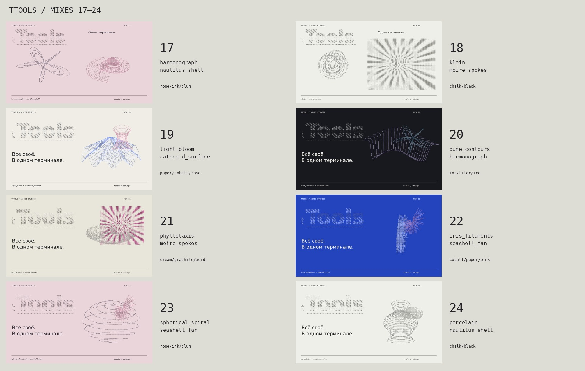
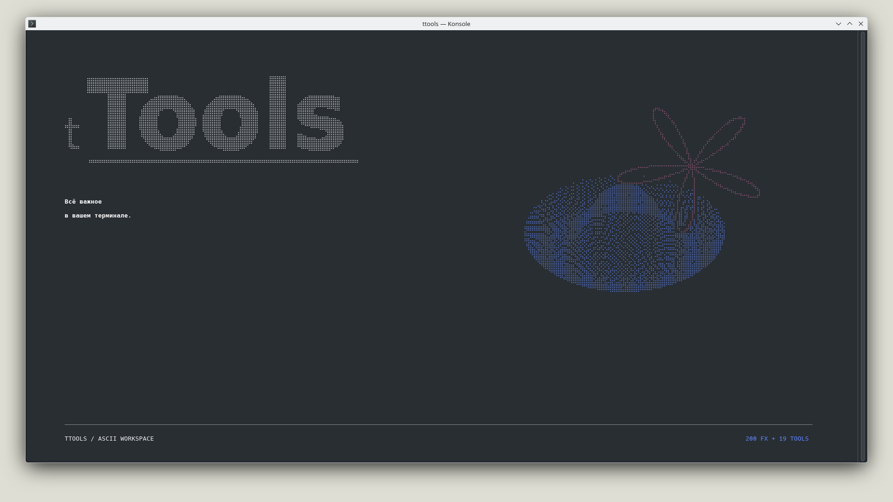
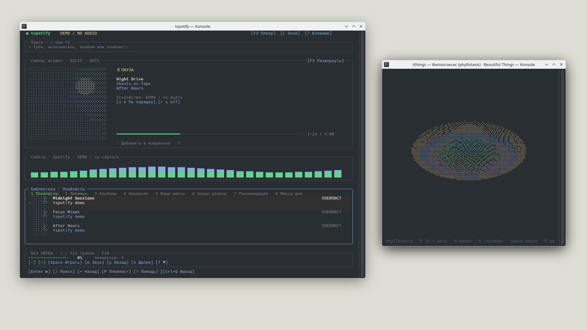
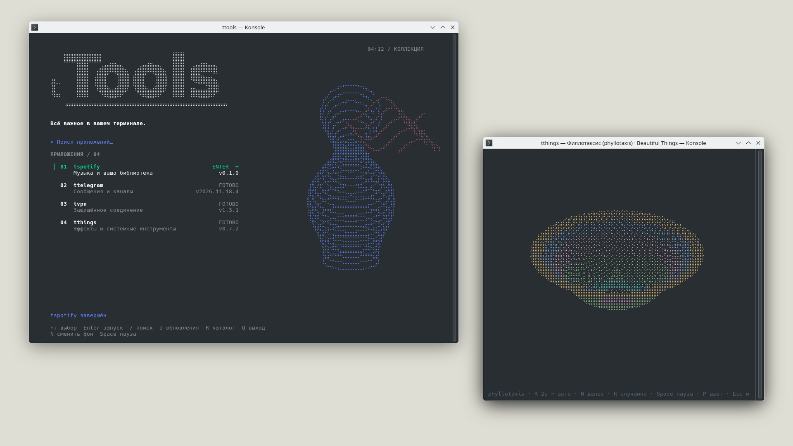

# ttools / ASCII studies

Сочетания построены из существующих эффектов tthings. Это художественные композиции, не скриншоты рабочего стола. Понравившийся исходный вариант сохранён как **00**; остальные пока кандидаты для выбора.

## 01–08

## 09–16

## 17–24

Каждый PNG — 1600×900. Полные изображения: [каталог studies](assets/studies). Номера, seed, пары сцен и палитры записаны в [manifest.json](assets/studies/manifest.json).

## Движение

[01](assets/studies/mix-01.gif) · [02](assets/studies/mix-02.gif) · [03](assets/studies/mix-03.gif) · [04](assets/studies/mix-04.gif) · [05](assets/studies/mix-05.gif) · [06](assets/studies/mix-06.gif)

## Каталог tthings

[Обзор всех 200 эффектов](EFFECTS.md).

## Новая заставка лаунчера

Подпись: «Всё важное / в вашем терминале.». Профиль и прозрачность терминала не переключаются.

## Рабочие столы

Шесть кадров настоящих окон Konsole, 1920×1080. Spotify работает в demo, Telegram — на вымышленном аккаунте, TVPN — без подключения. Для читаемости сеть и переписка показаны в разных композициях. [Как повторить безопасную съёмку](MEDIA.md).

### 01 / Музыка и сеть

### 02 / Music & Focus

### 03 / Terminal Gallery

### 04 / Daily Setup

### 05 / Minimal

### 06 / Experimental

Отдельный большой сайт пока не нужен: GitHub и эта галерея покрывают знакомство с проектом. Позже можно добавить простую статическую страницу с переключением палитр и живым ASCII, используя тот же каталог, без нового веб-фреймворка.
