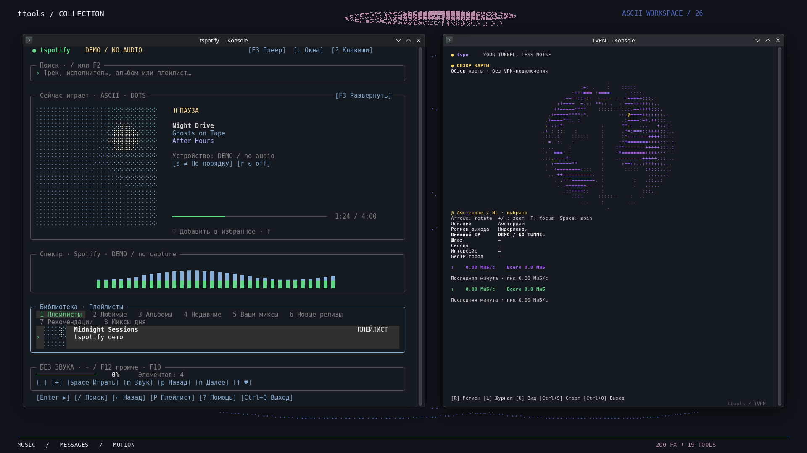
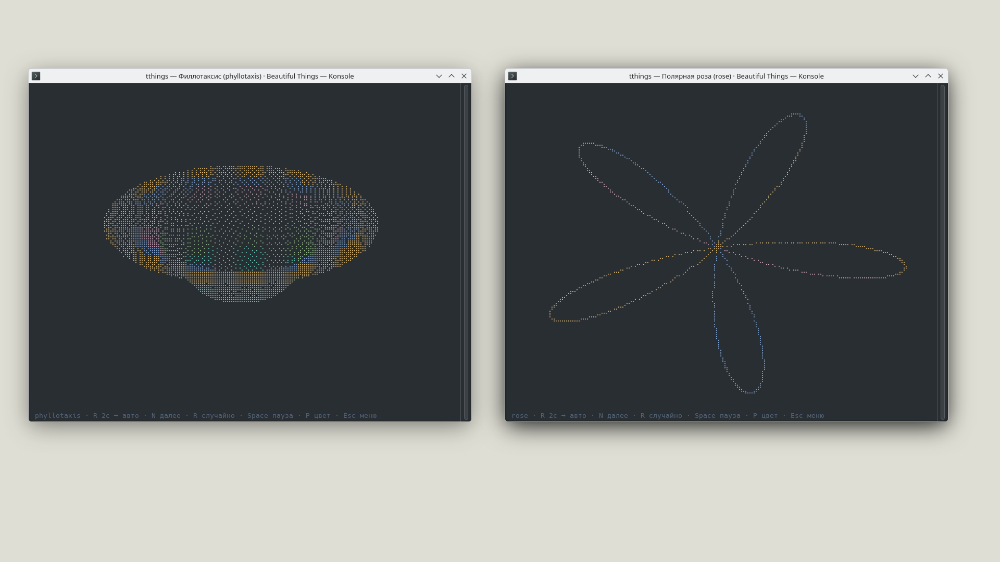
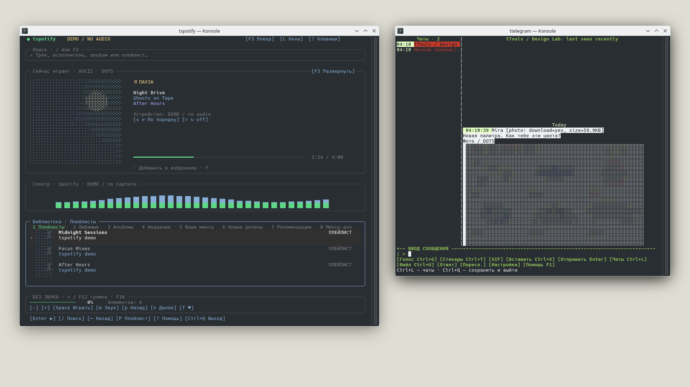
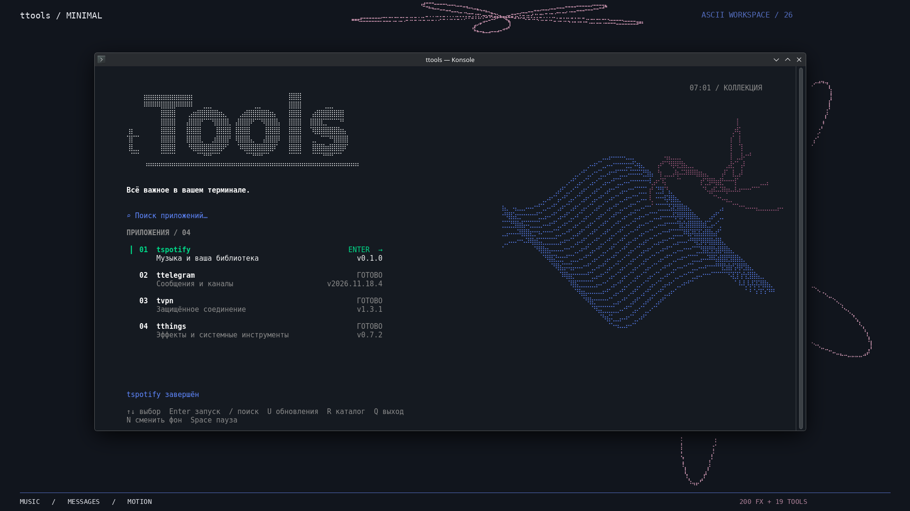
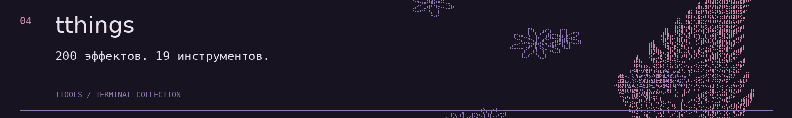
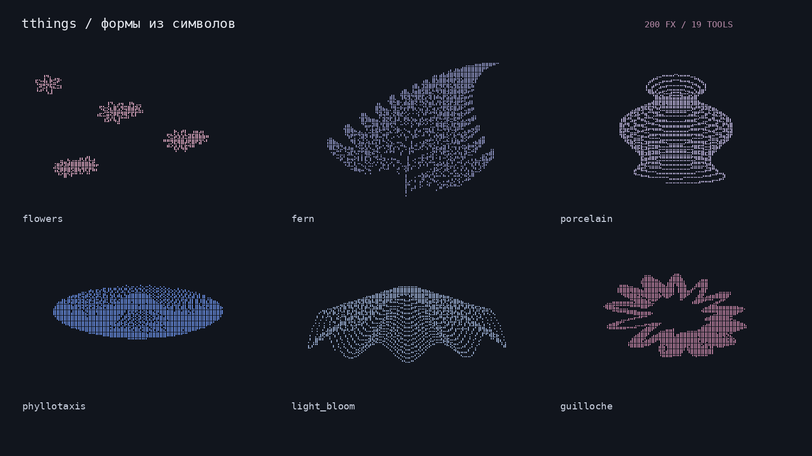

# ttools / рабочие пространства и графика

Шесть композиций, пять приложений и пять отобранных графических сочетаний. Тёмные фоны, символьные формы и свободные поля связывают отдельные окна в одно пространство.

## 01 / Музыка и сеть

Большой музыкальный интерфейс рядом с картой и индикаторами TVPN. В этой композиции два крупных окна: переписка вынесена в Daily Setup, чтобы не уменьшать глобус ради количества панелей.

## 02 / Music & Focus

Холодные волны на полях, музыкальная библиотека и одна живая сцена. Графика занимает свободное место под правым окном.

## 03 / Terminal Gallery

Две самостоятельные сцены tthings и ботанический орнамент на фоне. Сиреневые и розовые акценты остаются спокойными.

## 04 / Daily Setup

Музыка и разговор. Оптические формы появляются в промежутках между окнами, не под строками сообщений.

## 05 / Minimal

Лаунчер, две формы справа и большое свободное поле. Прозрачность и фон самого приложения остаются настройками терминала.

## 06 / Experimental

Более насыщенный кобальтовый стол с лаунчером и отдельной ASCII-сценой.

## Ближе к приложениям

Полные снимки: [Spotify](assets/app-spotify.png), [крупный плеер](assets/app-spotify-player.png), [Telegram](assets/app-telegram.png), [TVPN](assets/app-vpn.png), [tthings](assets/app-tthings.png).

В README эти интерфейсы показаны крупно и сопровождаются описаниями. Все снимки приложений и рабочих столов — 1920×1080, без растягивания. У окон настоящие интерфейсы: Spotify demo, вымышленная переписка Telegram, карта TVPN без туннеля и работающие сцены tthings. Это захваты изолированного рабочего стола, не программные коллажи окон.

## Пять сочетаний вместо новой пачки

| Исходный микс | Что использовано | Где появился |
| --- | --- | --- |
| **00** | light_bloom + rose | Главный баннер, экспериментальная композиция |
| **02** | iris_filaments + porcelain | Раздел Telegram, Daily Setup |
| **03** | lissajous + nautilus_shell | Раздел TVPN, музыка и сеть |
| **04** | truchet_tiles + dune_contours | Раздел Spotify, Music & Focus |
| **07** | flowers + fern | Раздел tthings, ботаническая галерея |

Это развитие уже созданных работ: новые эффекты и ещё 24 варианта не добавлялись. Цвет и размещение адаптированы к тёмным композициям. [Манифест отбора](assets/editorial-selection.json).

Архив первых 24 исследований сохранён в [studies](assets/studies); это история поиска, не текущие фоны приложений. [Обзор всех 200 эффектов](EFFECTS.md).

## Заставка

Подпись: «Всё важное / в вашем терминале.». Лаунчер не переключает профиль или прозрачность пользовательского терминала.

[Источники медиа и повторение съёмки](MEDIA.md).
